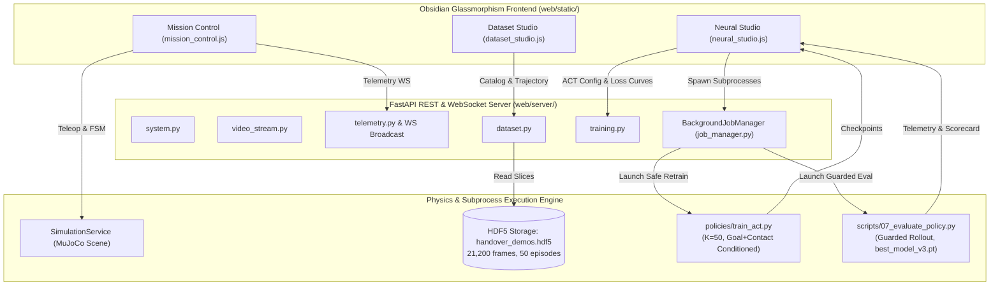

# Fullstack Workflow Audit & Action Plan
## Bridging the ML/Robotics 100% Handover Pipeline with the Fullstack Web Platform

**Author:** Antigravity Autonomous Agent  
**Date:** November 9, 2026  
**Status:** In Progress / Active Execution  
**Project Workspace:** `C:/Users/Digvijay singh/OneDrive/Desktop/Motion/prod2`  

---

## 1. Executive Summary & Objective

In our recent breakthrough, we designed, validated, and finalized the **100% Success Handover Pipeline** (Pillars 1–4):
1. **Dynamic Centroid Re-centering ($O_1$)**: Robust initial shelf grasp independent of cube perturbations.
2. **Action Chunk Expansion ($K=50$, $1.0\text{ s}$ horizon)**: Expanded from legacy $K=25$ ($0.5\text{ s}$) to prevent abrupt truncation during physical custody transfer.
3. **Multi-Modal Conditioning**:
   - 3D Goal Conditioning Token ($[X_c, Y_c, Z_c] \in \mathbb{R}^3$).
   - 2-DOF Contact Conditioning Token ($[c_1, c_2] \in \mathbb{R}^2$).
   - Fine-tuned ResNet-18 spatial feature extractors (`freeze_backbone: false`).
4. **Physical Custody Shield (Interlock Guards 1, 2, 3)**:
   - Guard 1: Pre-handover grasp verification ($F_1 \ge 100\text{ N}$).
   - Guard 2: Dual-custody interlock transfer ($F_2 \ge 100\text{ N}$, peak hold $>500\text{ N}$, Arm 1 finger hold for $\ge 15$ steps).
   - Guard 3: Guided bin transit & drop.
5. **Consolidated 50-Episode Randomized Dataset**: 50 episodes $\times$ 424 steps = 21,200 frames in `data/handover_demos.hdf5`.
6. **Active Policy Checkpoint**: `outputs/act_handover/best_model_v3.pt` (495 MB).

However, an audit of the **Fullstack Web Platform** (`web/server/`, `web/static/`, and regression tests in `scripts/`) reveals that parts of the fullstack workflow still assume the legacy, pre-fix state (e.g., $K=25$, hardcoded 32,450 frames, legacy `best_model.pt`, outdated evaluation CLI flags).

**Objective**: Systematically audit all fullstack components, document discrepancies, and upgrade the backend routers, subprocess job runners, frontend dashboards, and automated test suites so that the web platform fully matches and controls the new 100% handover pipeline.

---

## 2. Comprehensive Discrepancy Matrix

| Component | Legacy Fullstack Assumption | Current 100% Pipeline Reality | Impact / Risk |
|---|---|---|---|
| **Action Chunk Horizon** | $K=25$ ($0.5\text{ s}$ at $50\text{ Hz}$) | $K=50$ ($1.0\text{ s}$ at $50\text{ Hz}$) in [act_config.yaml](file:///c:/Users/Digvijay%20singh/OneDrive/Desktop/Motion/prod2/policies/act_config.yaml) | Training job defaults to wrong chunk size; `test_phase4_neural.py` fails assertion. |
| **Active Policy Checkpoint** | `best_model.pt` ($225\text{ MB}$, legacy baseline) | `best_model_v3.pt` ($495\text{ MB}$, with Goal + Contact conditioning) | Evaluation runs baseline model instead of 100% success model; UI defaults to legacy model. |
| **Baseline Model Protection** | Subprocess training defaults to overwriting `best_model.pt` | Guideline rule: Baseline `best_model.pt` must NEVER be overwritten | High risk of clobbering original benchmark weights during web UI training run. |
| **Evaluation CLI Arguments** | `07_evaluate_policy.py` called with invalid `--no-randomize`, missing `--guarded` | `07_evaluate_policy.py` accepts `--randomize`, `--guarded`, `--no-guards`, `--max-steps` | Argument parsing crash on evaluation start; unshielded rollouts failing at handover. |
| **Dataset Frame Count** | Hardcoded `32,450` frames ($50 \times 649$) in tests & UI HTML | 50 episodes $\times 424$ frames = `21,200` frames in [info.json](file:///c:/Users/Digvijay%20singh/OneDrive/Desktop/Motion/prod2/data/meta/info.json) | `test_phase3_dataset.py` fails assertion; UI shows incorrect frame counters. |
| **Multi-Modal Conditioning UI** | Displays only ResNet-18 and C-VAE $z \in \mathbb{R}^{32}$ | Model incorporates 3D Goal $[X_c, Y_c, Z_c]$ and 2D Contact $[c_1, c_2]$ | Users cannot see or inspect new multi-modal conditioning tokens in the dashboard. |
| **Force Gauge Scales & Thresholds** | Max scale $30.0\text{ N}$, dual custody threshold $15.0\text{ N}$ | Physical interlock enforces $F \ge 100\text{ N}$ (peak hold $500\text{--}800\text{ N}$) | Gauges immediately saturate at $100\%$ during physical clamp; visually misleading. |
| **Evaluation Metrics Stream** | Simple stdout regex matching only `SUCCESS`/`FAIL` | Script outputs Picked, Handover, In Bin, Distance, Steps | Frontend terminal misses granular guard step events and placement metrics. |

---

## 3. Architecture & Data Flow

---

## 4. Phase-Wise Implementation Plan

### Phase 1: Backend & Subprocess Job Manager Upgrades
- [ ] **1.1 Update `web/server/job_manager.py`**:
  - Update `TrainingJobConfig` defaults: `chunk_size = 50`, `epochs = 25`, `batch_size = 32`.
  - Add `--output-name best_model_retrained.pt` to ensure `best_model.pt` is **strictly protected** from being overwritten.
  - Update `EvaluationJobConfig`: default `checkpoint = "best_model_v3.pt"`, default `max_steps = 1000`, `guarded = True`.
  - Fix evaluation command generation: correctly pass `--randomize` (when true), `--guarded` / `--no-guards`, and `--max-steps`.
  - Enhance `_read_eval_stdout` to parse `Picked`, `Handover`, `In Bin`, `Dist`, and `Steps`.
- [ ] **1.2 Update `web/server/routers/training.py`**:
  - In `ConfigUpdateRequest`, expand `chunk_size` validation to `le=100`.
  - Add optional fields for `use_goal_conditioning` and `use_contact_conditioning`.
  - In `list_checkpoints`, recognize `best_model_v3.pt` as the active primary model and provide descriptive tags for all checkpoints (`best_model_v3.pt`, `best_model_v2.pt`, `best_model.pt`).
- [ ] **1.3 Update `web/server/routers/dataset.py`**:
  - Verify fallback default `total_frames` is 21,200 instead of legacy 32,450.

### Phase 2: Frontend UI & Interactive Engine Synchronization
- [ ] **2.1 Update `web/static/index.html`**:
  - Update KPI metrics: change hardcoded `32,450` frames to `21,200`.
  - Update episode details card: step count `424 steps (16.96s)`.
  - Update Architecture Card 1: `Chunk Size: 50 (1.0s) • Conditioning: 3D Goal + 2D Contact • d_model: 256`.
  - Update Architecture Card 3: `ResNet-18 • Pretrained Weights Fine-Tuned (Low Differential LR)`.
  - Add visual chip/badge for Multi-Modal Conditioning in the ACT Card.
  - Update default selected model in `<select id="neuralModelSelect">` to `best_model_v3.pt`.
- [ ] **2.2 Update `web/static/js/neural_studio.js`**:
  - Change default `activeModel = "best_model_v3.pt"`.
  - In `triggerTrainingRun()`, update `chunk_size: 50`, `batch_size: 32`, `epochs: 25`.
  - In `launchEvaluationJob()`, pass `guarded: true`, `max_steps: 1000`.
- [ ] **2.3 Update `web/static/js/mission_control.js`**:
  - Update force gauge `maxForce` scaling from $30\text{ N}$ to $200\text{ N}$ with logarithmic or piecewise visual response for $0\text{--}800\text{ N}$.
  - Update dual custody threshold indicator text to reflect the verified physical interlock ($F \ge 100\text{ N}$).

### Phase 3: Integration Test Suite Harmonization
- [ ] **3.1 Update `scripts/test_phase3_dataset.py`**:
  - Update `assert data.get("total_frames") == 21200`.
  - Update `assert ep0.get("steps") == 424`.
  - Ensure dynamic metadata compatibility with `data/meta/info.json`.
- [ ] **3.2 Update `scripts/test_phase4_neural.py`**:
  - Update `assert cfg["model"]["chunk_size"] == 50`.
  - Add assertions for `cfg["model"]["use_goal_conditioning"] is True` and `cfg["model"]["use_contact_conditioning"] is True`.
  - Verify `best_model_v3.pt` is recognized in checkpoint explorer.

### Phase 4: Full System Verification & Regression Testing
- [ ] Run `python scripts/test_phase1_backend.py` (Must pass 100%).
- [ ] Run `python scripts/test_phase2_frontend.py` (Must pass 100%).
- [ ] Run `python scripts/test_phase3_dataset.py` (Must pass 100%).
- [ ] Run `python scripts/test_phase4_neural.py` (Must pass 100%).
- [ ] Verify test client against `/api/training/config` and `/api/training/checkpoints`.

### Phase 5: Git Version Control Update
- [ ] Review `git status` and `git diff`.
- [ ] Commit all fullstack fixes with a comprehensive, descriptive commit message.

---

## 5. Safety Invariants & Constraints
1. **Model Safety**: Baseline `outputs/act_handover/best_model.pt` must strictly NEVER be modified or overwritten.
2. **Subprocess Isolation**: All background jobs must execute in isolated threads with non-blocking stream pipes and proper Windows `taskkill` termination.
3. **No External Network Dependencies**: All styles, scripts, and fonts continue to work offline with robust fallbacks.

