# Complete End-to-End Pipeline & Commands Guide
### Phase 6 (Demonstrations) → Phase 7 (Policy Training) → Phase 8 (MuJoCo Evaluation & Visualization)

This guide provides the complete, authoritative manual for collecting expert demonstrations, training the Action Chunking with Transformers (ACT) imitation learning policy, inspecting `.pt` model checkpoints, and running interactive 3D simulations in MuJoCo.

---

## 📌 Quick-Reference Workflow Summary

```mermaid
flowchart LR
    P6["Phase 6: Collect Demos<br/><code>scripts/06_collect_demos.py</code>"] -->|"HDF5 Dataset<br/>(RGBs + States + Actions)"| DATA["data/handover_demos.hdf5<br/>data/meta/stats.json"]
    DATA --> P7["Phase 7: Train Policy<br/><code>policies/train_act.py</code>"]
    P7 -->|"Model Weights<br/>(PyTorch Checkpoint)"| PT["outputs/act_handover/<br/>best_model.pt"]
    PT --> P8["Phase 8: Evaluate & Visualize<br/><code>scripts/07_evaluate_policy.py</code>"]
    P8 --> VIEW["Interactive 3D MuJoCo Window<br/>or HD Video Recording"]
```



---

## 1. Phase 6: Expert Demonstration Dataset Collection

Phase 6 uses the perception stack and 16-state Finite State Machine (FSM) to autonomously execute the pick, shelf extraction, mid-air handover, and bin placement sequence, recording synchronized multi-camera RGB images and 14-DOF robot actions.

### 🚀 Commands to Collect Demonstrations

#### A. High-Performance Multi-Core Parallel Collection (RECOMMENDED - 10x Faster!):
*Spawns 6 isolated worker processes across your multi-core CPU (e.g. Intel Core Ultra 7), reducing 50-episode collection time from ~8 hours down to ~35-45 minutes:*
```powershell
.\.venv\Scripts\python scripts/06_collect_demos_parallel.py --num-episodes 50 --num-workers 6 --fps 25 --randomize
```

#### B. Collect Demonstrations Sequentially (Single Worker):
```powershell
.\.venv\Scripts\python scripts/06_collect_demos.py --num-episodes 10 --randomize --render-quality fast
```

#### C. Fresh Start (Overwrite Old Dataset):
*Overwrites existing dataset instead of appending to it:*
```powershell
.\.venv\Scripts\python scripts/06_collect_demos_parallel.py --num-episodes 50 --num-workers 6 --overwrite
```

#### D. State-Only Collection (Super Fast, for Kinematic Debugging):
```powershell
.\.venv\Scripts\python scripts/06_collect_demos_parallel.py --num-episodes 50 --num-workers 6 --no-images
```

---

### 📋 Phase 6 Parallel CLI Flags Reference (`scripts/06_collect_demos_parallel.py`)

| Parameter / Flag | Type | Default | Description |
| :--- | :---: | :---: | :--- |
| `--num-episodes` | `int` | `50` | Total number of **successful** demonstrations to record. Failed attempts are automatically retried. |
| `--num-workers` | `int` | `6` | Number of parallel worker processes. On an 8-core CPU (Intel Core Ultra 7), `6` leaves 2 cores for OS responsiveness. |
| `--fps` | `int` | `25` | Control sampling frequency in Hz. `25` is recommended (halves camera renders and aligns with ACT chunking). |
| `--randomize` | flag | `True` | Applies domain randomization: cube initial position is perturbed ($\pm 3.0\text{ cm}$) and yaw angle ($\pm 25^\circ$) inside the shelf. |
| `--render-quality` | `str` | `compact` | Camera resolution preset: `compact` ($112\times 112$ matches ACT input directly), `fast` ($320\times 240$ Top, $160\times 120$ Wrists), or `standard`. |
| `--save-images` | flag | `True` | Records RGB image streams from Top, Wrist 1, and Wrist 2 cameras. |
| `--no-images` | flag | — | Saves only joint positions and actions (no camera rendering; runs in under 30 seconds). |
| `--overwrite` | flag | `False` | Overwrites the HDF5 file from scratch instead of appending new episodes to existing ones. |
| `--output-dir` | `str` | `data` | Directory where the `.hdf5` file and metadata will be saved. |
| `--dataset-name` | `str` | `handover_demos.hdf5` | Output HDF5 filename. |
| `--compression` | `str` | `lzf` | Compression algorithm (`lzf` for fast CPU throughput, `gzip` for smaller file sizes). |

---

### 🔍 Inspecting the Collected Demonstrations

To verify how many episodes you have, inspect data shapes, and check joint limits:

```powershell
.\.venv\Scripts\python -c "from dataset.dataset_utils import inspect_dataset; inspect_dataset('data/handover_demos.hdf5')"
```

---

## 2. Phase 7: ACT Policy Training

Phase 7 trains an **Action Chunking with Transformers (ACT)** policy. The model uses:
- **3 ResNet-18 Backbones**: Extract visual tokens from Overhead, Wrist 1, and Wrist 2 camera images.
- **Conditional VAE (C-VAE)**: Encodes multi-modal action distributions with latent vector $z \in \mathbb{R}^{32}$.
- **Transformer Encoder-Decoder**: Predicts a future chunk of $K=25$ time steps ($0.50\text{ s}$) at once to ensure temporally consistent motions.

### 🚀 Commands to Train the Policy

#### A. Standard Training Run (15 Epochs, Auto Device):
```powershell
.\.venv\Scripts\python policies/train_act.py
```

#### B. Extended Training for Higher Accuracy (30 Epochs, Larger Batch):
```powershell
.\.venv\Scripts\python policies/train_act.py --epochs 30 --batch-size 16 --lr 1e-4
```

#### C. Fast Verification Training (5 Epochs):
```powershell
.\.venv\Scripts\python policies/train_act.py --epochs 5 --batch-size 8
```

#### D. Force Specific Compute Device:
```powershell
# Run on CPU:
.\.venv\Scripts\python policies/train_act.py --device cpu

# Run on GPU (CUDA if available):
.\.venv\Scripts\python policies/train_act.py --device cuda
```

#### E. Custom Checkpoint Output Directory:
```powershell
.\.venv\Scripts\python policies/train_act.py --epochs 25 --save-dir outputs/experiment_25ep
```

---

### 📋 Phase 7 CLI Flags Reference (`policies/train_act.py`)

| Flag | Type | Default | Description |
| :--- | :---: | :---: | :--- |
| `--config` | `str` | `policies/act_config.yaml` | Path to master YAML configuration file. |
| `--epochs` | `int` | `15` | Total training epochs over the demonstration dataset. |
| `--batch-size` | `int` | `16` | Number of trajectory chunk samples per training batch. |
| `--lr` | `float` | `1e-4` | Transformer learning rate (AdamW optimizer). |
| `--device` | `str` | `auto` | Execution device: `auto`, `cpu`, or `cuda`. |
| `--save-dir` | `str` | `outputs/act_handover` | Output folder where `.pt` weights and logs are stored. |

---

### ⚙️ YAML Hyperparameters Reference (`policies/act_config.yaml`)

You can edit [`policies/act_config.yaml`](file:///c:/Users/Digvijay%20singh/OneDrive/Desktop/Motion/prod2/policies/act_config.yaml) to customize model architecture and training parameters:

```yaml
dataset:
  hdf5_path: "data/handover_demos.hdf5" # Source demonstration dataset
  stats_path: "data/meta/stats.json"   # Min/max normalization file
  camera_names: ["top", "wrist1", "wrist2"] # Input camera views
  input_image_size: [112, 112]         # Downscaled resolution for ResNet backbones
  step_stride: 2                       # Subsampling stride along demonstration trajectory

model:
  chunk_size: 25        # K=25: Model predicts 25 steps (0.50s) into the future
  state_dim: 14         # 14-DOF joint positions (6 Arm1 + 1 Grip1 + 6 Arm2 + 1 Grip2)
  action_dim: 14        # 14-DOF action vector
  d_model: 256          # Hidden dimension of transformer embeddings
  nheads: 8             # Multi-head attention heads
  enc_layers: 3         # Transformer encoder layers
  dec_layers: 3         # Transformer decoder layers
  dim_feedforward: 1024 # Feedforward network expansion dimension
  latent_dim: 32        # Latent dimension z of C-VAE style encoder
  backbone: "resnet18"  # Visual feature extractor
  freeze_backbone: true # Freeze ResNet weights (speeds up training significantly)

training:
  batch_size: 16
  lr_backbone: 1.0e-5   # Learning rate for visual backbone
  lr_transformer: 1.0e-4# Learning rate for transformer
  kl_weight: 10.0       # Beta weight for C-VAE KL divergence loss: L = L1 + beta * KL
  num_epochs: 15
  save_every: 5         # Save snapshot checkpoint every N epochs
  checkpoint_dir: "outputs/act_handover"
```

---

### 📦 Understanding Output Files & `.pt` Checkpoints

When training completes, the following files are saved in `outputs/act_handover/`:

| Output File | Description |
| :--- | :--- |
| **`best_model.pt`** | The best checkpoint based on validation loss. **This is the model loaded by default in Phase 8.** |
| **`checkpoint_epoch_X.pt`** | Periodic snapshot checkpoints saved every `save_every` epochs (e.g. `checkpoint_epoch_5.pt`, `checkpoint_epoch_10.pt`). |
| **`train_history.json`** | JSON log of loss per epoch: `train_loss`, `val_loss`, `l1_loss`, and `kl_loss`. |
| **`data/meta/stats.json`** | Normalization parameters ($\text{qpos}_{\min}, \text{qpos}_{\max}, \text{action}_{\min}, \text{action}_{\max}$). Required during evaluation to scale network predictions back to radian angles. |

---

## 3. Phase 8: Policy Evaluation & 3D MuJoCo Simulation

Phase 8 executes the trained `.pt` policy in closed-loop: camera frames are captured from MuJoCo, fed into the `.pt` model, and predicted joint trajectories are applied to the robots in real time.

### 🚀 Commands to Run & Visualize the Trained Policy

#### A. Interactive 3D MuJoCo Window (Watch Live):
*Opens the native 3D MuJoCo desktop GUI. You can orbit the camera, zoom in, and watch the dual arms pick and handover the cube:*
```powershell
.\.venv\Scripts\python scripts/07_evaluate_policy.py --viewer --no-ensemble --replan-freq 20
```

#### B. Explicitly Specify the `.pt` Checkpoint File:
*Test a specific model weight file:*
```powershell
# Test best model:
.\.venv\Scripts\python scripts/07_evaluate_policy.py --checkpoint outputs/act_handover/best_model.pt --viewer --no-ensemble --replan-freq 20

# Test a specific epoch checkpoint:
.\.venv\Scripts\python scripts/07_evaluate_policy.py --checkpoint outputs/act_handover/checkpoint_epoch_15.pt --viewer --no-ensemble --replan-freq 20
```

#### C. Smooth Temporal Ensembling:
*Blends overlapping action chunks using exponential temporal ensembling ($m=0.20$):*
```powershell
.\.venv\Scripts\python scripts/07_evaluate_policy.py --viewer --infer-stride 5
```

#### D. Domain Randomization Evaluation:
*Randomizes the starting position and orientation of the cube inside the shelf to verify generalization:*
```powershell
.\.venv\Scripts\python scripts/07_evaluate_policy.py --viewer --randomize --no-ensemble --replan-freq 20
```

#### E. Multi-Trial Headless Benchmark (Success Scorecard):
*Runs 5 consecutive evaluation trials without rendering graphics and prints an aggregate success scorecard:*
```powershell
.\.venv\Scripts\python scripts/07_evaluate_policy.py --num-episodes 5 --no-ensemble --replan-freq 20
```

#### F. Render and Record Multi-Camera HD Video:
*Renders high-definition $960\times 480$ composite video with HUD overlay to `recordings/phase8_act_eval_rollout.mp4`:*
```powershell
.\.venv\Scripts\python scripts/07_evaluate_policy.py --record --no-ensemble --replan-freq 20 --num-episodes 1
```

---

### 📋 Phase 8 CLI Flags & Parameters Reference (`scripts/07_evaluate_policy.py`)

| Parameter / Flag | Type | Default | Description |
| :--- | :---: | :---: | :--- |
| `--checkpoint` | `str` | `outputs/act_handover/best_model.pt` | Path to the trained PyTorch `.pt` model checkpoint. |
| `--viewer` | flag | `False` | Launches the interactive native 3D MuJoCo desktop window. |
| `--speed` | `float` | `1.0` | Playback speed multiplier when viewer is active (e.g. `0.5` for slow-motion, `2.0` for fast). |
| `--record` | flag | `False` | Renders and records $960\times 480$ composite video (Overhead $+ 2$ Wrists $+$ HUD) to `recordings/`. |
| `--num-episodes` | `int` | `1` (viewer) / `5` (headless) | Number of evaluation episodes/trials to run. |
| `--max-steps` | `int` | `1400` | Maximum control steps per episode ($1,400\text{ steps} = 28.0\text{ seconds}$ at $50\text{ Hz}$). |
| `--randomize` | flag | `False` | Perturbs initial cube position and orientation in shelf. |
| `--no-ensemble` | flag | `False` | Disables temporal ensembling; uses receding horizon query every `replan-freq` steps (faster on CPU). |
| `--replan-freq` | `int` | `10` | Step interval at which the policy queries the network when `--no-ensemble` is set (e.g. 10 or 20). |
| `--infer-stride` | `int` | `1` | Stride interval in steps for ensembling queries (default `1` for GPU; use `5` on CPU). |
| `--ensemble-decay` | `float` | `0.20` | Exponential weighting factor $m$ for temporal ensembling ($w_i = \exp(-m \cdot i)$). |
| `--device` | `str` | `auto` | Hardware compute device: `auto`, `cpu`, or `cuda`. |

---

### 🎮 MuJoCo 3D Viewer Interactive Controls

When running with `--viewer`:
- **Rotate View**: Left Click $+$ Drag
- **Zoom In / Out**: Right Click $+$ Drag or Scroll Wheel
- **Pan / Translate**: Middle Click $+$ Drag (or Shift $+$ Left Click $+$ Drag)
- **Pause / Resume**: Press `Spacebar`
- **Single Step Forward**: Press `Backspace` (while paused)
- **Center Camera on Object**: Double Click on any robot link, shelf, or cube
- **Toggle Information HUD**: Press `F1` (help), `F2` (info), `F3` (sensor telemetry)
- **Exit Viewer**: Press `Esc` or close window

---

## 4. End-to-End Retraining Recipe (From Scratch)

If you want to train a brand new, high-capacity model from scratch:

```powershell
# Step 1: Collect 50 randomized expert demonstrations
.\.venv\Scripts\python scripts/06_collect_demos.py --num-episodes 50 --randomize --overwrite

# Step 2: Inspect collected dataset to confirm 50 valid episodes
.\.venv\Scripts\python -c "from dataset.dataset_utils import inspect_dataset; inspect_dataset('data/handover_demos.hdf5')"

# Step 3: Train the ACT policy for 25 epochs
.\.venv\Scripts\python policies/train_act.py --epochs 25 --batch-size 16 --lr 1e-4

# Step 4: Watch the new model in 3D MuJoCo simulation
.\.venv\Scripts\python scripts/07_evaluate_policy.py --checkpoint outputs/act_handover/best_model.pt --viewer --no-ensemble --replan-freq 20

# Step 5: Benchmark quantitative success rate over 10 trials
.\.venv\Scripts\python scripts/07_evaluate_policy.py --checkpoint outputs/act_handover/best_model.pt --num-episodes 10 --no-ensemble --replan-freq 20
```
