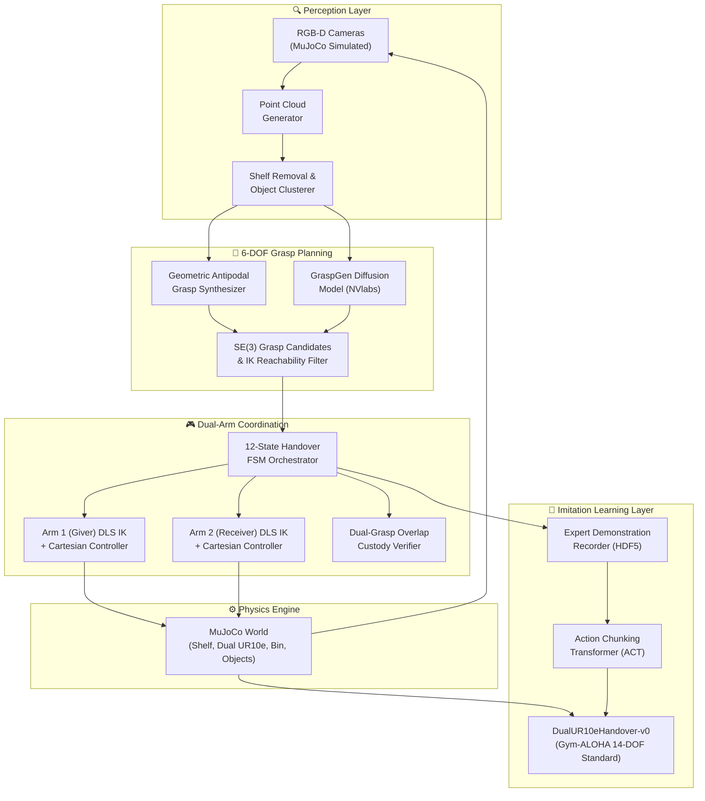

# Robotic Pick-and-Handover System

[](https://mujoco.org/)
[](https://github.com/google-deepmind/mujoco_menagerie)
[](https://github.com/huggingface/lerobot)
[](LICENSE)

An end-to-end autonomous dual-arm robotic manipulation system simulated in **MuJoCo**. The system coordinates two collaborative **Universal Robots UR10e** manipulators with **Robotiq 2F-85** parallel-jaw grippers to execute vision-guided shelf picking, synchronized mid-air handover, and bin placement.

---

## 📌 System Architecture



---

## 🚀 Key Features

- **High-Fidelity Dual-Arm Simulation**: Dual Universal Robots UR10e arms mounted on opposite sides of a shared workspace with Robotiq 2F-85 adaptive grippers.
- **Vision-Guided 6-DOF Grasping**: Synthetic depth sensing and back-projected 3D point clouds paired with a dual-track grasp planner (native geometric antipodal sampler + NVlabs/GraspGen interface).
- **Fail-Safe Mid-Air Handover**: Robust 12-state Finite State Machine with a strict dual-grasp overlap window (both grippers hold simultaneously before transfer of custody) and collision avoidance corridors.
- **Gym-ALOHA Compatible**: Gymnasium environment adhering to the ALOHA / LeRobot 14-DOF action standard (6 joint positions + 1 gripper state per arm) and multi-view RGB observations.
- **End-to-End Imitation Learning**: Scripted expert trajectory recording to HDF5 datasets and training of Action Chunking Transformers (ACT) with temporal ensembling.

---

## 🗂️ Project Structure

```
.
├── README.md                  # System overview and entry point
├── SETUP_GUIDE.md             # Environment setup & interactive 3D viewer guide
├── PIPELINE_GUIDE.md          # End-to-end command reference (Data, Training, Eval)
├── dual_arm_architecture.md   # Mathematical & kinematic architectural specification
├── learning/                  # In-depth subsystem documentation guides
│   ├── overview.md            # System architectural whitepaper
│   ├── 01_simulation_scene.md # Physics world, MJCF scene & sensors
│   ├── 02_kinematics_control.md# DLS IK, null-space optimization & Cartesian control
│   ├── 03_perception_grasp.md # Synthetic depth, point clouds & 6-DOF grasp planning
│   ├── 04_scripted_handover.md# 16-stage bimanual handover FSM & dual custody
│   ├── 05_gym_aloha.md        # Gym-ALOHA 14-DOF Gymnasium environment
│   ├── 06_expert_demos.md     # Multi-worker parallel demonstration recorder
│   └── 07_act_policy.md       # ACT policy architecture & C-VAE training
├── assets/                    # Robot models, meshes, and environment textures
├── models/                    # MJCF XML scene definitions (dual UR10e, shelf, bin)
├── control/                   # Kinematics, DLS IK solver, and Cartesian controllers
├── perception/                # Point cloud generation, segmentation, grasp planners
├── fsm/                       # Dual-arm handover state machine and safety interlocks
├── envs/                      # Gymnasium ALOHA environment wrapper
├── dataset/                   # Demonstration recording and dataset utilities
├── policies/                  # ACT configuration and training scripts
└── scripts/                   # Verification, collection, training, and evaluation utilities
```

---

## 📚 System Modules & Technical Documentation

The system is organized into modular engineering subsystems, each documented with architecture breakdowns, mathematical formulations, and verification benchmarks:

| Module | Subsystem Guide | Core Capabilities | Status |
|:---:|---|---|:---:|
| **1** | [**Simulation Scene & Assets**](learning/01_simulation_scene.md) | Dual UR10e manipulators, Robotiq 2F-85 4-bar linkage dynamics, 4×3 wall shelf, multi-camera sensor suite | 🟢 Verified |
| **2** | [**Kinematics & Control**](learning/02_kinematics_control.md) | Damped Least Squares (DLS) numerical IK, null-space postural biasing, 5th-order minimum-jerk trajectory generator | 🟢 Verified |
| **3** | [**Perception & 6-DOF Grasping**](learning/03_perception_grasp.md) | Metric depth back-projection, RANSAC plane removal, DBSCAN clustering, antipodal grasp synthesis | 🟢 Verified |
| **4** | [**Coordinated Handover FSM**](learning/04_scripted_handover.md) | 16-state deterministic coordinator, closed-loop dual-custody force interlock, collision-free corridors | 🟢 Verified |
| **5** | [**Gym-ALOHA Environment**](learning/05_gym_aloha.md) | Gymnasium environment standard, 14-DOF normalized action space, multi-camera image observation dictionary | 🟢 Verified |
| **6** | [**Demonstration Engine**](learning/06_expert_demos.md) | 6-worker parallel recorder, Stanford ALOHA HDF5 schema, LeRobot metadata export, domain randomization | 🟢 Verified |
| **7** | [**Visuomotor Policy (ACT)**](learning/07_act_policy.md) | Action Chunking with Transformers (K=25), multi-view ResNet-18 backbones, C-VAE latent style generator | 🟢 Verified |

> 📖 **Comprehensive Pipeline Manual**: See [`PIPELINE_GUIDE.md`](PIPELINE_GUIDE.md) for full parameter references, flags, and recipes.  
> 📖 **Interactive 3D Viewer Guide**: See [`SETUP_GUIDE.md`](SETUP_GUIDE.md) for camera navigation, physics shortcuts, and environment setup.  
> 📖 **Architectural Blueprint**: See [`dual_arm_architecture.md`](dual_arm_architecture.md) for complete mathematical derivations and control loops.

---

## 🛠️ Quickstart

### Prerequisites
- Python 3.10 or 3.11
- Git

### Installation
```bash
# Clone the repository
git clone https://github.com/Digvijay2347/Robotic-Pick-and-Handover-System.git
cd Robotic-Pick-and-Handover-System

# Create and activate virtual environment
python -m venv .venv
# On Windows:
.venv\Scripts\activate
# On Linux/macOS:
source .venv/bin/activate

# Install dependencies
pip install -r requirements.txt
```

### Quick Commands

#### 1. Watch Trained ACT Policy in Interactive 3D MuJoCo Simulation:
```powershell
.\.venv\Scripts\python scripts/07_evaluate_policy.py --viewer --no-ensemble --replan-freq 20
```

#### 2. Record Multi-Camera HD Video of Autonomous Execution:
```powershell
.\.venv\Scripts\python scripts/07_evaluate_policy.py --record --no-ensemble --replan-freq 20 --num-episodes 1
```

#### 3. Collect Expert Demonstrations (Parallel 6 Workers):
```powershell
.\.venv\Scripts\python scripts/06_collect_demos_parallel.py --num-episodes 50 --num-workers 6 --fps 25 --randomize
```

#### 4. Train the ACT Policy:
```powershell
.\.venv\Scripts\python policies/train_act.py --epochs 25 --batch-size 16
```

---

## 📖 References

- [MuJoCo Menagerie](https://github.com/google-deepmind/mujoco_menagerie)
- [NVlabs / GraspGen](https://github.com/NVlabs/GraspGen)
- [Hugging Face / LeRobot](https://github.com/huggingface/lerobot)
- [Gym-ALOHA](https://github.com/huggingface/gym-aloha)
- [ALOHA: Learning Fine-Grained Bimanual Manipulation with Low-Cost Hardware](https://tonyzhaozh.github.io/aloha/)

---

## 👤 Author
**Digvijay Singh**  
GitHub: [@Digvijay2347](https://github.com/Digvijay2347)  
Portfolio: [singhdigvijay.vercel.app](https://singhdigvijay.vercel.app/)
