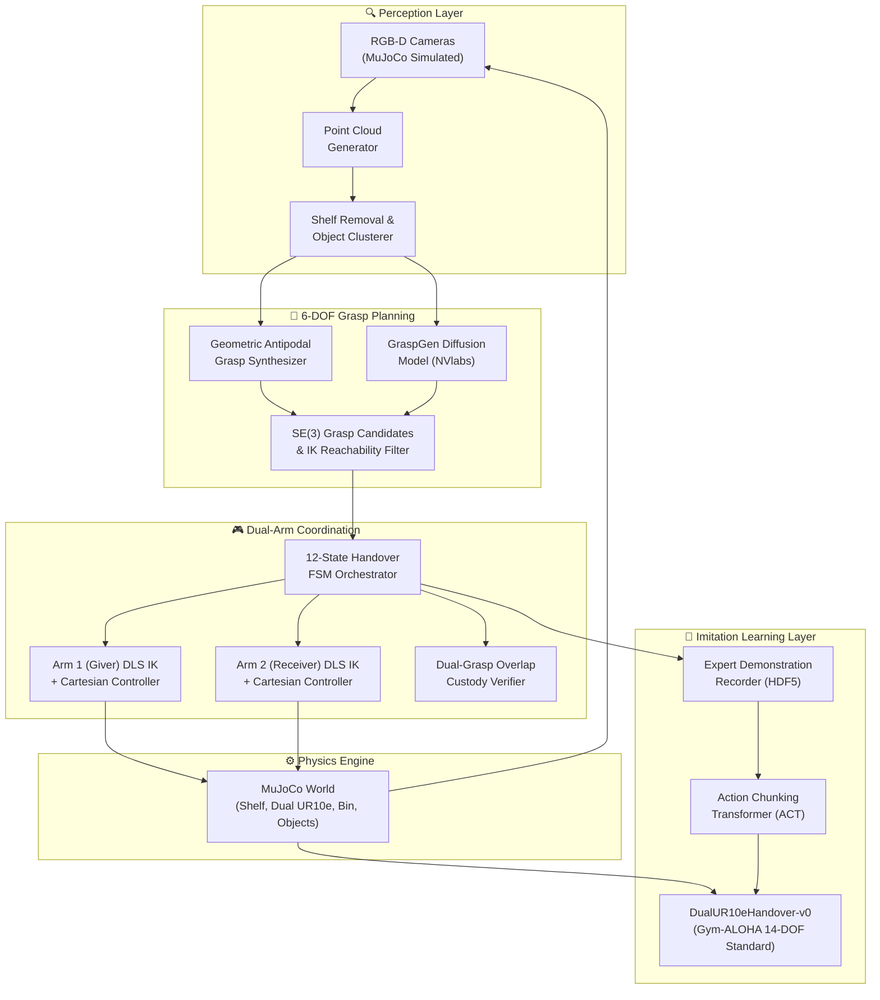

# Robotic Pick-and-Handover System

[](https://mujoco.org/)
[](https://github.com/google-deepmind/mujoco_menagerie)
[](https://github.com/huggingface/lerobot)
[](LICENSE)

An end-to-end autonomous dual-arm robotic manipulation system simulated in **MuJoCo**. The system coordinates two collaborative **Universal Robots UR10e** manipulators with **Robotiq 2F-85** parallel-jaw grippers to execute vision-guided shelf picking, synchronized mid-air handover, and bin placement.

---

## 📌 System Architecture



---

## 🚀 Key Features

- **High-Fidelity Dual-Arm Simulation**: Dual Universal Robots UR10e arms mounted on opposite sides of a shared workspace with Robotiq 2F-85 adaptive grippers.
- **Vision-Guided 6-DOF Grasping**: Synthetic depth sensing and back-projected 3D point clouds paired with a dual-track grasp planner (native geometric antipodal sampler + NVlabs/GraspGen interface).
- **Fail-Safe Mid-Air Handover**: Robust 12-state Finite State Machine with a strict dual-grasp overlap window (both grippers hold simultaneously before transfer of custody) and collision avoidance corridors.
- **Gym-ALOHA Compatible**: Gymnasium environment adhering to the ALOHA / LeRobot 14-DOF action standard (6 joint positions + 1 gripper state per arm) and multi-view RGB observations.
- **End-to-End Imitation Learning**: Scripted expert trajectory recording to HDF5 datasets and training of Action Chunking Transformers (ACT) with temporal ensembling.

---

## 🗂️ Project Structure

```
.
├── dual_arm_architecture.md   # Detailed system architectural specification
├── implementation_plan.md     # Phased step-by-step engineering roadmap
├── assets/                    # Robot models, meshes, and environment textures
├── models/                    # MJCF XML scene definitions (dual UR10e, shelf, bin)
├── control/                   # Kinematics, DLS IK solver, and Cartesian controllers
├── perception/                # Point cloud generation, segmentation, grasp planners
├── fsm/                       # Dual-arm handover state machine and safety interlocks
├── envs/                      # Gymnasium ALOHA environment wrapper
├── dataset/                   # Demonstration recording and dataset utilities
├── policies/                  # ACT configuration and training scripts
├── scripts/                   # Verification, testing, and benchmark utilities
└── README.md
```

---

## 📋 Implementation Roadmap

| Phase | Milestone | Status |
|:---:|---|:---:|
| **0** | **Environment & Tooling Setup** | 🟢 Complete |
| **1** | **MJCF Scene & Asset Assembly** | 🟢 Complete |
| **2** | **Kinematics & Single-Arm Pick Baseline** | 🟢 Complete |
| **3** | **Perception & 6-DOF Grasp Planning** | 🟢 Complete |
| **4** | **Coordinated Dual-Arm Handover FSM** | 🟢 Complete |
| **5** | **Gym-ALOHA Environment Wrapper** | 🟢 Complete |
| **6** | **Expert Demonstration Dataset Collection** | 🟢 Complete |
| **7** | **Policy Training (ACT / LeRobot)** | 🟢 Complete |
| **8** | **Benchmarking, Telemetry & Polish** | 🟢 Complete |

> 📖 **Comprehensive Pipeline Manual**: See [`PIPELINE_GUIDE.md`](PIPELINE_GUIDE.md) for full parameter references, flags, and recipes for Phases 6, 7, and 8.  
> 📖 Full architecture and step-by-step logs: [`implementation_plan.md`](implementation_plan.md) and [`SETUP_GUIDE.md`](SETUP_GUIDE.md).

---

## 🛠️ Quickstart

### Prerequisites
- Python 3.10 or 3.11
- Git

### Installation
```bash
# Clone the repository
git clone https://github.com/Digvijay2347/Robotic-Pick-and-Handover-System.git
cd Robotic-Pick-and-Handover-System

# Create and activate virtual environment
python -m venv .venv
# On Windows:
.venv\Scripts\activate
# On Linux/macOS:
source .venv/bin/activate

# Install dependencies
pip install -r requirements.txt
```

### Quick Commands

#### 1. Watch Trained ACT Policy in 3D MuJoCo Simulation (Phase 8):
```powershell
.\.venv\Scripts\python scripts/07_evaluate_policy.py --viewer --no-ensemble --replan-freq 20
```

#### 2. Record Multi-Camera HD Video of Trained Policy:
```powershell
.\.venv\Scripts\python scripts/07_evaluate_policy.py --record --no-ensemble --replan-freq 20 --num-episodes 1
```

#### 3. Collect Expert Demonstrations (Phase 6):
```powershell
.\.venv\Scripts\python scripts/06_collect_demos.py --num-episodes 50 --randomize
```

#### 4. Train the ACT Policy (Phase 7):
```powershell
.\.venv\Scripts\python policies/train_act.py --epochs 25 --batch-size 16
```

---

## 📖 References

- [MuJoCo Menagerie](https://github.com/google-deepmind/mujoco_menagerie)
- [NVlabs / GraspGen](https://github.com/NVlabs/GraspGen)
- [Hugging Face / LeRobot](https://github.com/huggingface/lerobot)
- [Gym-ALOHA](https://github.com/huggingface/gym-aloha)
- [ALOHA: Learning Fine-Grained Bimanual Manipulation with Low-Cost Hardware](https://tonyzhaozh.github.io/aloha/)

---

## 👤 Author
**Digvijay Singh**  
GitHub: [@Digvijay2347](https://github.com/Digvijay2347)  
Portfolio: [singhdigvijay.vercel.app](https://singhdigvijay.vercel.app/)
