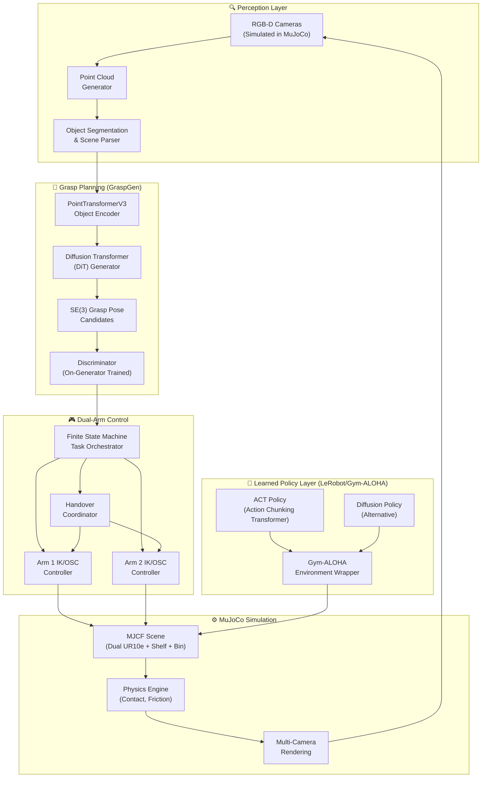
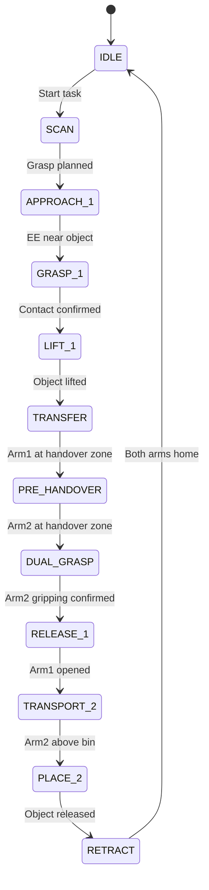

# Dual-Arm Robotic Pick-and-Handover System
## Architecture & Implementation Blueprint

> **System**: Dual UR10e arms · MuJoCo simulation · GraspGen 6-DOF grasping · LeRobot/Gym-ALOHA coordination

---

## 1. System Architecture Overview



---

## 2. Component Breakdown

### 2.1 MuJoCo Scene (MJCF)

The simulation world consists of five major element groups:

| Element | Source | Details |
|---|---|---|
| **UR10e Arms (×2)** | [MuJoCo Menagerie](https://github.com/google-deepmind/mujoco_menagerie) `universal_robots_ur10e/` | 6-DOF each; attach Robotiq 2F-85 grippers |
| **Wall Shelf/Cupboard** | Custom MJCF | Multi-compartment static body with box geometries |
| **Objects** | Custom or [YCB Dataset](https://www.ycbbenchmarks.com/) meshes | Free-joint bodies placed inside shelf compartments |
| **Storage Bin** | Custom MJCF | Open-top container with collision walls |
| **Environment** | Custom MJCF | Floor, lighting, camera mounts |

#### Proposed Physical Layout

```
                    ┌─────────────────────────────────┐
                    │         WALL SHELF (4×3 grid)    │
                    │  ┌───┬───┬───┬───┐              │
                    │  │ 📦│ 🥫│ 📕│ 🧴│  ← Objects   │
                    │  ├───┼───┼───┼───┤              │
                    │  │ 🔧│   │ 📱│ 🍎│              │
                    │  ├───┼───┼───┼───┤              │
                    │  │   │ 🧪│   │ 🎲│              │
                    │  └───┴───┴───┴───┘              │
                    └─────────────────────────────────┘
                                  ↑
                          ARM 1 (Giver)
                         reach zone
                              │
                    ┌─────────┼─────────┐
                    │     WORKSPACE      │
          ┌────┐   │                     │   ┌────┐
          │ARM │←──│  ★ HANDOVER POINT   │──→│ARM │
          │ 1  │   │     (mid-air)       │   │ 2  │
          │UR10e   │                     │   │UR10e
          └────┘   └─────────────────────┘   └────┘
                              │
                          ARM 2 (Receiver)
                         reach zone
                              ↓
                    ┌─────────────────────┐
                    │    STORAGE BIN 📥    │
                    └─────────────────────┘
```

#### Arm Placement Configuration

```python
# Arm 1 (Giver) - Faces the shelf, right side
ARM1_BASE_POS = [0.5, 0.0, 0.8]    # x, y, z (on a pedestal or table-mounted)
ARM1_BASE_QUAT = [1, 0, 0, 0]       # facing +Y (toward shelf)

# Arm 2 (Receiver) - Faces the bin, left side
ARM2_BASE_POS = [-0.5, 0.0, 0.8]
ARM2_BASE_QUAT = [0, 0, 0, 1]       # facing -Y (toward bin)

# Handover Point - Center of shared workspace
HANDOVER_POINT = [0.0, 0.0, 1.0]    # reachable by both arms
```

---

### 2.2 GraspGen Integration (6-DOF Grasp Planning)

GraspGen provides the perception-to-grasp pipeline for Arm 1. Here's how each component maps:


#### Key Integration Points

1. **Simulated Depth Camera**: Mount an RGB-D camera in MuJoCo pointing at the shelf
   ```xml
   <camera name="shelf_rgbd" pos="0.5 -0.8 1.2" xyaxes="0 1 0 0 0 1"
           fovy="60" resolution="640 480"/>
   ```

2. **Point Cloud from Depth**: Use MuJoCo's `mj_ray` or render depth buffers → back-project to 3D
   ```python
   depth = mujoco.mj_render(model, data, camera_id, depth=True)
   points = backproject_depth_to_pointcloud(depth, intrinsics)
   ```

3. **GraspGen Inference**: Run the pre-trained model to get SE(3) grasp poses
   ```python
   from graspgen import GraspGenModel

   model_gg = GraspGenModel.load_pretrained("graspgen_parallel_jaw")
   grasp_poses = model_gg.generate(point_cloud, num_grasps=50)  # returns (K, 4, 4) SE(3)
   best_grasp = model_gg.discriminate(grasp_poses, point_cloud)  # top-1 filtered
   ```

4. **SE(3) → Joint Angles**: Convert the selected 6-DOF pose into UR10e joint configurations
   ```python
   target_qpos = inverse_kinematics(
       model, data, site_name="arm1_ee_site",
       target_pos=best_grasp[:3, 3],
       target_quat=mat2quat(best_grasp[:3, :3])
   )
   ```

---

### 2.3 Dual-Arm Coordination (LeRobot / Gym-ALOHA Inspired)

The coordination layer manages the synchronized handover. Two approaches are available:

#### Approach A: Scripted State Machine (Baseline)



#### Approach B: Learned Policy (ACT via LeRobot)

Using `gym-aloha`-style environment wrapping with a **14-DOF action space** (6 joints + 1 gripper per arm):

```python
import gymnasium as gym

class DualUR10eHandoverEnv(gym.Env):
    """Custom Gym environment wrapping the MuJoCo dual-arm scene."""

    def __init__(self):
        super().__init__()
        self.model = mujoco.MjModel.from_xml_path("dual_ur10e_scene.xml")
        self.data = mujoco.MjData(self.model)

        # Action: 14-dim (6 joints + 1 gripper) × 2 arms
        self.action_space = gym.spaces.Box(
            low=-1.0, high=1.0, shape=(14,), dtype=np.float32
        )

        # Observation: joint pos/vel + camera images
        self.observation_space = gym.spaces.Dict({
            "qpos": gym.spaces.Box(-np.inf, np.inf, shape=(14,)),
            "qvel": gym.spaces.Box(-np.inf, np.inf, shape=(14,)),
            "top_cam": gym.spaces.Box(0, 255, shape=(480, 640, 3), dtype=np.uint8),
            "wrist1_cam": gym.spaces.Box(0, 255, shape=(480, 640, 3), dtype=np.uint8),
            "wrist2_cam": gym.spaces.Box(0, 255, shape=(480, 640, 3), dtype=np.uint8),
        })

    def step(self, action):
        # Map action[0:7] → Arm 1 joints+gripper
        # Map action[7:14] → Arm 2 joints+gripper
        self.data.ctrl[:7] = action[:7]
        self.data.ctrl[7:14] = action[7:14]
        mujoco.mj_step(self.model, self.data)

        obs = self._get_obs()
        reward = self._compute_reward()
        done = self._check_success()
        return obs, reward, done, False, {}

    def _compute_reward(self):
        """Multi-phase reward shaping for handover."""
        r = 0.0
        # Phase 1: Arm1 approach → object proximity reward
        r += -np.linalg.norm(self.arm1_ee_pos - self.object_pos)
        # Phase 2: Successful grasp bonus
        if self.arm1_grasping:
            r += 5.0
        # Phase 3: Handover proximity
        if self.arm1_grasping:
            r += -np.linalg.norm(self.arm1_ee_pos - self.handover_point)
            r += -np.linalg.norm(self.arm2_ee_pos - self.handover_point)
        # Phase 4: Successful transfer + placement
        if self.arm2_grasping and self.object_in_bin:
            r += 50.0
        return r
```

Train using LeRobot's ACT:
```bash
python lerobot/scripts/train.py \
  --policy.type=act \
  --dataset.repo_id=your_handover_demonstrations \
  --env.type=custom \
  --env.task=DualUR10eHandover-v0
```

---

## 3. Technical Pipeline (End-to-End)

```mermaid
flowchart TB
    subgraph Phase1["Phase 1: Scene Setup"]
        A1["Build MJCF<br/>(shelf, arms, bin)"]
        A2["Load UR10e from<br/>MuJoCo Menagerie"]
        A3["Attach Robotiq<br/>2F-85 grippers"]
        A4["Place objects in<br/>shelf compartments"]
        A5["Mount simulated<br/>RGB-D cameras"]
    end

    subgraph Phase2["Phase 2: Perception & Grasp Planning"]
        B1["Render depth from<br/>shelf camera"]
        B2["Generate point cloud<br/>(back-projection)"]
        B3["Segment target<br/>object"]
        B4["Run GraspGen<br/>inference"]
        B5["Select best SE(3)<br/>grasp pose"]
    end

    subgraph Phase3["Phase 3: Arm 1 Execution"]
        C1["IK solve for<br/>pre-grasp pose"]
        C2["Move Arm 1 to<br/>pre-grasp"]
        C3["Final approach<br/>(Cartesian)"]
        C4["Close gripper<br/>(verify contact)"]
        C5["Lift object<br/>from shelf"]
    end

    subgraph Phase4["Phase 4: Coordinated Handover"]
        D1["Arm 1 moves to<br/>handover point"]
        D2["Arm 2 moves to<br/>pre-receive pose"]
        D3["Arm 2 gripper<br/>closes on object"]
        D4["Verify dual-grasp<br/>stability"]
        D5["Arm 1 releases<br/>(open gripper)"]
    end

    subgraph Phase5["Phase 5: Placement"]
        E1["Arm 2 transports<br/>to bin"]
        E2["Lower into bin"]
        E3["Release object"]
        E4["Retract both<br/>arms to home"]
    end

    Phase1 --> Phase2 --> Phase3 --> Phase4 --> Phase5
```



---

## 4. Step-by-Step Implementation Strategy

### Step 1: Environment Setup & Dependencies

```bash
# Create conda environment
conda create -n dual_arm_handover python=3.10
conda activate dual_arm_handover

# Core simulation
pip install mujoco mujoco-python-viewer

# MuJoCo Menagerie (UR10e models)
git clone https://github.com/google-deepmind/mujoco_menagerie.git

# Gym-ALOHA (for environment patterns)
pip install gym-aloha gymnasium

# LeRobot (for policy training)
git clone https://github.com/huggingface/lerobot.git
cd lerobot && pip install -e .

# GraspGen (6-DOF grasp generation)
git clone https://github.com/NVlabs/GraspGen.git
cd GraspGen && pip install -e .

# Utilities
pip install numpy scipy transforms3d open3d imageio
```

---

### Step 2: Build the MJCF Scene

Create `dual_ur10e_scene.xml`:

```xml
<mujoco model="dual_ur10e_handover">
  <compiler angle="radian" meshdir="meshes/"/>

  <option timestep="0.002" gravity="0 0 -9.81" integrator="implicitfast"/>

  <default>
    <joint armature="0.1" damping="1.0"/>
    <geom condim="3" friction="1.0 0.005 0.0001"/>
  </default>

  <asset>
    <!-- UR10e meshes loaded via include -->
    <texture name="grid" type="2d" builtin="checker" width="512" height="512"
             rgb1="0.2 0.3 0.4" rgb2="0.1 0.15 0.2"/>
    <material name="floor_mat" texture="grid" texrepeat="8 8"/>
    <material name="shelf_mat" rgba="0.65 0.45 0.25 1"/>
    <material name="bin_mat" rgba="0.3 0.3 0.8 0.8"/>
  </asset>

  <worldbody>
    <!-- Floor -->
    <geom name="floor" type="plane" size="3 3 0.1" material="floor_mat"/>
    <light pos="0 0 3" dir="0 0 -1" diffuse="0.8 0.8 0.8"/>
    <light pos="1 1 2" dir="-0.5 -0.5 -1" diffuse="0.5 0.5 0.5"/>

    <!-- ============ WALL SHELF ============ -->
    <body name="shelf" pos="0 1.2 0">
      <!-- Back wall -->
      <geom type="box" size="0.8 0.02 0.9" pos="0 0 0.9" material="shelf_mat"/>
      <!-- Shelves (3 levels) -->
      <geom type="box" size="0.8 0.25 0.015" pos="0 -0.12 0.45" material="shelf_mat"/>
      <geom type="box" size="0.8 0.25 0.015" pos="0 -0.12 0.90" material="shelf_mat"/>
      <geom type="box" size="0.8 0.25 0.015" pos="0 -0.12 1.35" material="shelf_mat"/>
      <!-- Vertical dividers -->
      <geom type="box" size="0.015 0.25 0.45" pos="-0.4 -0.12 0.68" material="shelf_mat"/>
      <geom type="box" size="0.015 0.25 0.45" pos="0.0  -0.12 0.68" material="shelf_mat"/>
      <geom type="box" size="0.015 0.25 0.45" pos="0.4  -0.12 0.68" material="shelf_mat"/>
    </body>

    <!-- ============ OBJECTS ON SHELF ============ -->
    <body name="target_object" pos="-0.2 1.0 0.50">
      <joint type="free"/>
      <geom type="box" size="0.03 0.03 0.06" rgba="1 0.2 0.2 1" mass="0.15"/>
    </body>

    <body name="object_2" pos="0.2 1.0 0.50">
      <joint type="free"/>
      <geom type="cylinder" size="0.025 0.05" rgba="0.2 0.8 0.2 1" mass="0.1"/>
    </body>

    <!-- ============ ARM 1 (GIVER) - Right side, faces shelf ============ -->
    <body name="arm1_base" pos="0.6 0.4 0.75" quat="0.707 0 0 0.707">
      <!-- Include UR10e model here -->
      <include file="mujoco_menagerie/universal_robots_ur10e/ur10e.xml"/>
    </body>

    <!-- ============ ARM 2 (RECEIVER) - Left side, faces bin ============ -->
    <body name="arm2_base" pos="-0.6 0.4 0.75" quat="0.707 0 0 -0.707">
      <!-- Include second UR10e model here (with renamed joints/actuators) -->
      <include file="ur10e_arm2.xml"/>
    </body>

    <!-- ============ STORAGE BIN ============ -->
    <body name="bin" pos="0 -0.8 0">
      <geom type="box" size="0.25 0.25 0.005" pos="0 0 0.01" material="bin_mat"/>
      <geom type="box" size="0.25 0.01 0.15" pos="0 0.24 0.15" material="bin_mat"/>
      <geom type="box" size="0.25 0.01 0.15" pos="0 -0.24 0.15" material="bin_mat"/>
      <geom type="box" size="0.01 0.25 0.15" pos="0.24 0 0.15" material="bin_mat"/>
      <geom type="box" size="0.01 0.25 0.15" pos="-0.24 0 0.15" material="bin_mat"/>
    </body>

    <!-- ============ CAMERAS ============ -->
    <camera name="shelf_cam" pos="0.5 0.5 1.2" xyaxes="0 -1 0 0.5 0 1" fovy="60"/>
    <camera name="overhead_cam" pos="0 0 2.5" xyaxes="1 0 0 0 1 0" fovy="90"/>
    <camera name="handover_cam" pos="0 -0.3 1.2" xyaxes="1 0 0 0 0 1" fovy="60"/>
  </worldbody>

  <!-- ============ ACTUATORS ============ -->
  <actuator>
    <!-- Arm 1: 6 position-controlled joints + 1 gripper -->
    <position name="arm1_j0" joint="arm1_shoulder_pan"  kp="500"/>
    <position name="arm1_j1" joint="arm1_shoulder_lift" kp="500"/>
    <position name="arm1_j2" joint="arm1_elbow"         kp="500"/>
    <position name="arm1_j3" joint="arm1_wrist_1"       kp="200"/>
    <position name="arm1_j4" joint="arm1_wrist_2"       kp="200"/>
    <position name="arm1_j5" joint="arm1_wrist_3"       kp="200"/>
    <position name="arm1_gripper" joint="arm1_finger"    kp="100"/>

    <!-- Arm 2: Mirror of Arm 1 -->
    <position name="arm2_j0" joint="arm2_shoulder_pan"  kp="500"/>
    <position name="arm2_j1" joint="arm2_shoulder_lift" kp="500"/>
    <position name="arm2_j2" joint="arm2_elbow"         kp="500"/>
    <position name="arm2_j3" joint="arm2_wrist_1"       kp="200"/>
    <position name="arm2_j4" joint="arm2_wrist_2"       kp="200"/>
    <position name="arm2_j5" joint="arm2_wrist_3"       kp="200"/>
    <position name="arm2_gripper" joint="arm2_finger"    kp="100"/>
  </actuator>

  <!-- Collision exclusions to prevent self-collision issues -->
  <contact>
    <exclude body1="arm1_base" body2="arm1_shoulder"/>
    <exclude body1="arm2_base" body2="arm2_shoulder"/>
  </contact>
</mujoco>
```

> [!NOTE]
> The actual `<include>` usage requires creating properly namespaced copies of the UR10e MJCF for Arm 2 (renaming all joints, bodies, and actuators with an `arm2_` prefix). MuJoCo Menagerie provides the base, which you'll duplicate and rename.

---

### Step 3: Core Control Module

```python
# control/dual_arm_controller.py

import mujoco
import numpy as np
from scipy.spatial.transform import Rotation as R

class DualArmController:
    """Manages both UR10e arms with IK-based Cartesian control."""

    def __init__(self, model, data):
        self.model = model
        self.data = data

        # Arm 1 (Giver) joint/actuator indices
        self.arm1_joint_ids = [model.joint(f"arm1_j{i}").id for i in range(6)]
        self.arm1_grip_id = model.actuator("arm1_gripper").id
        self.arm1_ee_site = model.site("arm1_ee").id

        # Arm 2 (Receiver) joint/actuator indices
        self.arm2_joint_ids = [model.joint(f"arm2_j{i}").id for i in range(6)]
        self.arm2_grip_id = model.actuator("arm2_gripper").id
        self.arm2_ee_site = model.site("arm2_ee").id

    def get_ee_pose(self, arm: int) -> tuple[np.ndarray, np.ndarray]:
        """Get end-effector position and quaternion for arm 1 or 2."""
        site_id = self.arm1_ee_site if arm == 1 else self.arm2_ee_site
        pos = self.data.site_xpos[site_id].copy()
        rot_mat = self.data.site_xmat[site_id].reshape(3, 3)
        quat = R.from_matrix(rot_mat).as_quat()
        return pos, quat

    def ik_step(self, arm: int, target_pos: np.ndarray,
                target_quat: np.ndarray, step_size: float = 0.5):
        """One step of damped least-squares IK toward target pose."""
        site_id = self.arm1_ee_site if arm == 1 else self.arm2_ee_site
        joint_ids = self.arm1_joint_ids if arm == 1 else self.arm2_joint_ids

        # Current EE pose
        ee_pos = self.data.site_xpos[site_id]
        ee_mat = self.data.site_xmat[site_id].reshape(3, 3)

        # Position error
        pos_err = target_pos - ee_pos

        # Orientation error (axis-angle)
        target_mat = R.from_quat(target_quat).as_matrix()
        err_mat = target_mat @ ee_mat.T
        ori_err = R.from_matrix(err_mat).as_rotvec()

        # 6D error vector
        err = np.concatenate([pos_err, ori_err])

        # Compute Jacobian
        jacp = np.zeros((3, self.model.nv))
        jacr = np.zeros((3, self.model.nv))
        mujoco.mj_jacSite(self.model, self.data, jacp, jacr, site_id)

        # Extract columns for this arm's joints
        jac = np.vstack([
            jacp[:, [self.model.joint(j).dofadr[0] for j in joint_ids]],
            jacr[:, [self.model.joint(j).dofadr[0] for j in joint_ids]]
        ])

        # Damped least squares
        damping = 1e-4
        delta_q = jac.T @ np.linalg.solve(
            jac @ jac.T + damping * np.eye(6), err
        )

        # Apply joint updates
        for i, jid in enumerate(joint_ids):
            self.data.qpos[self.model.jnt_qposadr[jid]] += step_size * delta_q[i]

    def set_gripper(self, arm: int, value: float):
        """Set gripper position. 0.0 = open, 1.0 = closed."""
        grip_id = self.arm1_grip_id if arm == 1 else self.arm2_grip_id
        self.data.ctrl[grip_id] = value

    def check_grasp(self, arm: int, object_name: str) -> bool:
        """Check if arm's gripper has contact with the target object."""
        obj_id = mujoco.mj_name2id(self.model, mujoco.mjtObj.mjOBJ_BODY, object_name)
        grip_prefix = "arm1_finger" if arm == 1 else "arm2_finger"

        for i in range(self.data.ncon):
            contact = self.data.contact[i]
            geom1 = self.model.geom(contact.geom1).name
            geom2 = self.model.geom(contact.geom2).name
            body1 = self.model.body(self.model.geom(contact.geom1).bodyid).name
            body2 = self.model.body(self.model.geom(contact.geom2).bodyid).name

            if (grip_prefix in geom1 and body2 == object_name) or \
               (grip_prefix in geom2 and body1 == object_name):
                return True
        return False
```

---

### Step 4: GraspGen Perception Module

```python
# perception/grasp_planner.py

import numpy as np
import mujoco

class GraspPlanner:
    """Wraps GraspGen for MuJoCo-simulated perception."""

    def __init__(self, model, data, camera_name="shelf_cam"):
        self.model = model
        self.data = data
        self.cam_id = mujoco.mj_name2id(model, mujoco.mjtObj.mjOBJ_CAMERA, camera_name)
        self.width = 640
        self.height = 480

        # Load GraspGen model (pre-trained)
        from graspgen.model import GraspGenPipeline
        self.grasp_model = GraspGenPipeline.from_pretrained(
            checkpoint="graspgen_parallel_jaw_v1",
            device="cuda"
        )

    def capture_depth(self) -> np.ndarray:
        """Render depth image from the shelf camera."""
        renderer = mujoco.Renderer(self.model, self.height, self.width)
        renderer.update_scene(self.data, camera=self.cam_id)
        renderer.enable_depth_rendering(True)
        depth = renderer.render()
        renderer.close()
        return depth

    def depth_to_pointcloud(self, depth: np.ndarray) -> np.ndarray:
        """Back-project depth image into 3D point cloud."""
        fovy = self.model.cam_fovy[self.cam_id]
        f = self.height / (2.0 * np.tan(np.radians(fovy / 2.0)))
        cx, cy = self.width / 2.0, self.height / 2.0

        u, v = np.meshgrid(np.arange(self.width), np.arange(self.height))
        z = depth
        x = (u - cx) * z / f
        y = (v - cy) * z / f

        mask = z > 0.01  # filter invalid
        points = np.stack([x[mask], y[mask], z[mask]], axis=-1)

        # Transform from camera frame to world frame
        cam_pos = self.data.cam_xpos[self.cam_id]
        cam_mat = self.data.cam_xmat[self.cam_id].reshape(3, 3)
        points_world = (cam_mat @ points.T).T + cam_pos

        return points_world

    def plan_grasp(self, target_object_name: str = None) -> np.ndarray:
        """Full pipeline: capture → pointcloud → GraspGen → best SE(3) pose."""
        depth = self.capture_depth()
        point_cloud = self.depth_to_pointcloud(depth)

        # Optional: segment target object points only
        if target_object_name:
            point_cloud = self._segment_object(point_cloud, target_object_name)

        # Run GraspGen diffusion pipeline
        grasp_candidates = self.grasp_model.generate(
            point_cloud=point_cloud,
            num_grasps=64,
            diffusion_steps=50
        )  # shape: (64, 4, 4) SE(3) homogeneous matrices

        # Score and filter with discriminator
        scores = self.grasp_model.discriminate(grasp_candidates, point_cloud)
        best_idx = np.argmax(scores)

        return grasp_candidates[best_idx]  # (4, 4) SE(3) matrix

    def _segment_object(self, points, object_name):
        """Simple spatial segmentation based on known object position."""
        obj_id = mujoco.mj_name2id(
            self.model, mujoco.mjtObj.mjOBJ_BODY, object_name
        )
        obj_pos = self.data.xpos[obj_id]
        distances = np.linalg.norm(points - obj_pos, axis=1)
        mask = distances < 0.15  # 15cm radius
        return points[mask]
```

---

### Step 5: Task Orchestrator (Main Loop)

```python
# main.py — Full Handover Pipeline

import mujoco
import mujoco.viewer
import numpy as np
import time

from control.dual_arm_controller import DualArmController
from perception.grasp_planner import GraspPlanner

# ─── Configuration ───
HANDOVER_POINT = np.array([0.0, 0.0, 1.1])
HANDOVER_QUAT = np.array([1, 0, 0, 0])  # neutral orientation
BIN_DROP_POS = np.array([0.0, -0.8, 0.4])
TARGET_OBJECT = "target_object"
GRASP_THRESHOLD = 0.01   # 1cm
GRIPPER_OPEN = 0.0
GRIPPER_CLOSED = 0.8

# ─── State Machine ───
class State:
    IDLE = 0
    PLAN_GRASP = 1
    APPROACH_1 = 2
    GRASP_1 = 3
    LIFT_1 = 4
    TRANSFER_TO_HANDOVER = 5
    APPROACH_2 = 6
    DUAL_GRASP = 7
    RELEASE_1 = 8
    TRANSPORT_2 = 9
    PLACE_2 = 10
    RETRACT = 11
    DONE = 12

def main():
    # Load
    model = mujoco.MjModel.from_xml_path("dual_ur10e_scene.xml")
    data = mujoco.MjData(model)

    controller = DualArmController(model, data)
    planner = GraspPlanner(model, data, camera_name="shelf_cam")

    state = State.IDLE
    grasp_pose = None
    lift_target = None
    step_count = 0
    stabilize_count = 0

    with mujoco.viewer.launch_passive(model, data) as viewer:
        while viewer.is_running():
            t0 = time.time()

            # ══════════ STATE MACHINE ══════════

            if state == State.IDLE:
                print("[STATE] IDLE → Planning grasp...")
                state = State.PLAN_GRASP

            elif state == State.PLAN_GRASP:
                grasp_pose = planner.plan_grasp(target_object_name=TARGET_OBJECT)
                pre_grasp = grasp_pose.copy()
                pre_grasp[:3, 3] -= pre_grasp[:3, 2] * 0.08  # offset along approach
                print(f"[STATE] Grasp planned at {grasp_pose[:3, 3]}")
                state = State.APPROACH_1

            elif state == State.APPROACH_1:
                controller.ik_step(
                    arm=1,
                    target_pos=pre_grasp[:3, 3],
                    target_quat=mat2quat(pre_grasp[:3, :3])
                )
                controller.set_gripper(1, GRIPPER_OPEN)

                ee_pos, _ = controller.get_ee_pose(1)
                if np.linalg.norm(ee_pos - pre_grasp[:3, 3]) < GRASP_THRESHOLD:
                    print("[STATE] Pre-grasp reached → Final approach")
                    # Now move to actual grasp pose
                    controller.ik_step(
                        arm=1,
                        target_pos=grasp_pose[:3, 3],
                        target_quat=mat2quat(grasp_pose[:3, :3])
                    )
                    if np.linalg.norm(ee_pos - grasp_pose[:3, 3]) < GRASP_THRESHOLD:
                        state = State.GRASP_1

            elif state == State.GRASP_1:
                controller.set_gripper(1, GRIPPER_CLOSED)
                stabilize_count += 1
                if stabilize_count > 50:  # wait for contact to stabilize
                    if controller.check_grasp(1, TARGET_OBJECT):
                        print("[STATE] Object grasped! Lifting...")
                        obj_pos = data.body(TARGET_OBJECT).xpos.copy()
                        lift_target = obj_pos + np.array([0, 0, 0.15])
                        stabilize_count = 0
                        state = State.LIFT_1
                    else:
                        print("[WARN] Grasp failed, re-planning...")
                        stabilize_count = 0
                        state = State.PLAN_GRASP

            elif state == State.LIFT_1:
                controller.ik_step(arm=1, target_pos=lift_target,
                                   target_quat=HANDOVER_QUAT)
                ee_pos, _ = controller.get_ee_pose(1)
                if np.linalg.norm(ee_pos - lift_target) < GRASP_THRESHOLD:
                    print("[STATE] Lifted → Transferring to handover point")
                    state = State.TRANSFER_TO_HANDOVER

            elif state == State.TRANSFER_TO_HANDOVER:
                # Move Arm 1 toward handover, Arm 2 toward pre-receive
                controller.ik_step(arm=1, target_pos=HANDOVER_POINT,
                                   target_quat=HANDOVER_QUAT)
                pre_receive = HANDOVER_POINT + np.array([0, -0.05, 0])
                controller.ik_step(arm=2, target_pos=pre_receive,
                                   target_quat=HANDOVER_QUAT)
                controller.set_gripper(2, GRIPPER_OPEN)

                ee1, _ = controller.get_ee_pose(1)
                ee2, _ = controller.get_ee_pose(2)
                d1 = np.linalg.norm(ee1 - HANDOVER_POINT)
                d2 = np.linalg.norm(ee2 - pre_receive)
                if d1 < 0.02 and d2 < 0.02:
                    print("[STATE] Both arms at handover zone")
                    state = State.APPROACH_2

            elif state == State.APPROACH_2:
                # Arm 2 closes in on the object
                controller.ik_step(arm=2, target_pos=HANDOVER_POINT,
                                   target_quat=HANDOVER_QUAT)
                ee2, _ = controller.get_ee_pose(2)
                if np.linalg.norm(ee2 - HANDOVER_POINT) < GRASP_THRESHOLD:
                    state = State.DUAL_GRASP

            elif state == State.DUAL_GRASP:
                controller.set_gripper(2, GRIPPER_CLOSED)
                stabilize_count += 1
                if stabilize_count > 80:  # longer stabilization for dual grasp
                    if controller.check_grasp(2, TARGET_OBJECT):
                        print("[STATE] Dual grasp confirmed → Releasing Arm 1")
                        stabilize_count = 0
                        state = State.RELEASE_1

            elif state == State.RELEASE_1:
                controller.set_gripper(1, GRIPPER_OPEN)
                stabilize_count += 1
                if stabilize_count > 30:
                    print("[STATE] Arm 1 released → Arm 2 transporting")
                    stabilize_count = 0
                    state = State.TRANSPORT_2

            elif state == State.TRANSPORT_2:
                controller.ik_step(arm=2, target_pos=BIN_DROP_POS,
                                   target_quat=HANDOVER_QUAT)
                ee2, _ = controller.get_ee_pose(2)
                if np.linalg.norm(ee2 - BIN_DROP_POS) < 0.02:
                    state = State.PLACE_2

            elif state == State.PLACE_2:
                controller.set_gripper(2, GRIPPER_OPEN)
                stabilize_count += 1
                if stabilize_count > 30:
                    print("[STATE] Object placed in bin! ✓")
                    stabilize_count = 0
                    state = State.RETRACT

            elif state == State.RETRACT:
                # Return both arms to home positions
                home1 = np.array([0.6, 0.4, 1.2])
                home2 = np.array([-0.6, 0.4, 1.2])
                controller.ik_step(arm=1, target_pos=home1, target_quat=HANDOVER_QUAT)
                controller.ik_step(arm=2, target_pos=home2, target_quat=HANDOVER_QUAT)
                ee1, _ = controller.get_ee_pose(1)
                ee2, _ = controller.get_ee_pose(2)
                if (np.linalg.norm(ee1 - home1) < 0.05 and
                    np.linalg.norm(ee2 - home2) < 0.05):
                    print("[STATE] DONE — Full cycle complete!")
                    state = State.DONE

            elif state == State.DONE:
                pass  # idle

            # ══════════ PHYSICS STEP ══════════
            mujoco.mj_step(model, data)
            viewer.sync()
            step_count += 1

            dt = model.opt.timestep - (time.time() - t0)
            if dt > 0:
                time.sleep(dt)


def mat2quat(mat):
    """Convert 3×3 rotation matrix to quaternion [w, x, y, z]."""
    from scipy.spatial.transform import Rotation as R
    return R.from_matrix(mat).as_quat(scalar_first=True)


if __name__ == "__main__":
    main()
```

---

### Step 6: Gym-ALOHA Environment Wrapper (for Policy Training)

```python
# envs/dual_ur10e_gym.py

import gymnasium as gym
import numpy as np
import mujoco

class DualUR10eHandoverEnv(gym.Env):
    """
    Gymnasium environment for dual-arm handover,
    following the gym-aloha pattern for LeRobot compatibility.
    """
    metadata = {"render_modes": ["rgb_array"], "render_fps": 50}

    def __init__(self, render_mode="rgb_array", max_episode_steps=500):
        super().__init__()

        self.model = mujoco.MjModel.from_xml_path("dual_ur10e_scene.xml")
        self.data = mujoco.MjData(self.model)
        self.render_mode = render_mode
        self.max_steps = max_episode_steps
        self.step_count = 0

        # 14-DOF: 7 per arm (6 joints + 1 gripper)
        self.action_space = gym.spaces.Box(
            low=-1.0, high=1.0, shape=(14,), dtype=np.float32
        )

        self.observation_space = gym.spaces.Dict({
            "qpos": gym.spaces.Box(-np.inf, np.inf, shape=(14,), dtype=np.float64),
            "qvel": gym.spaces.Box(-np.inf, np.inf, shape=(14,), dtype=np.float64),
            "images": gym.spaces.Dict({
                "top":   gym.spaces.Box(0, 255, shape=(480, 640, 3), dtype=np.uint8),
                "wrist1": gym.spaces.Box(0, 255, shape=(480, 640, 3), dtype=np.uint8),
                "wrist2": gym.spaces.Box(0, 255, shape=(480, 640, 3), dtype=np.uint8),
            })
        })

        self._renderer = mujoco.Renderer(self.model, 480, 640)

    def reset(self, seed=None, options=None):
        super().reset(seed=seed)
        mujoco.mj_resetData(self.model, self.data)
        # Randomize object position slightly
        obj_jnt = self.model.joint("target_object_jnt").id
        self.data.qpos[self.model.jnt_qposadr[obj_jnt]:
                       self.model.jnt_qposadr[obj_jnt]+3] += \
            self.np_random.uniform(-0.02, 0.02, size=3)
        mujoco.mj_forward(self.model, self.data)
        self.step_count = 0
        return self._get_obs(), {}

    def step(self, action):
        # Scale actions to actuator ranges
        action = np.clip(action, -1, 1)
        ctrl_ranges = self.model.actuator_ctrlrange
        for i in range(14):
            low, high = ctrl_ranges[i]
            self.data.ctrl[i] = low + (action[i] + 1) / 2 * (high - low)

        # Step physics (5 substeps for stability at 200Hz internal / 50Hz control)
        for _ in range(5):
            mujoco.mj_step(self.model, self.data)

        self.step_count += 1
        obs = self._get_obs()
        reward = self._compute_reward()
        terminated = self._check_success()
        truncated = self.step_count >= self.max_steps
        return obs, reward, terminated, truncated, {}

    def _get_obs(self):
        return {
            "qpos": self.data.qpos[:14].copy(),
            "qvel": self.data.qvel[:14].copy(),
            "images": {
                "top":    self._render_camera("overhead_cam"),
                "wrist1": self._render_camera("arm1_wrist_cam"),
                "wrist2": self._render_camera("arm2_wrist_cam"),
            }
        }

    def _render_camera(self, cam_name):
        cam_id = mujoco.mj_name2id(
            self.model, mujoco.mjtObj.mjOBJ_CAMERA, cam_name
        )
        self._renderer.update_scene(self.data, camera=cam_id)
        return self._renderer.render()

    def _compute_reward(self):
        obj_pos = self.data.body("target_object").xpos
        bin_pos = np.array([0.0, -0.8, 0.15])
        dist_to_bin = np.linalg.norm(obj_pos - bin_pos)

        reward = 0.0
        # Dense: object closer to bin
        reward -= 0.1 * dist_to_bin
        # Sparse: object in bin
        if dist_to_bin < 0.1 and obj_pos[2] < 0.25:
            reward += 100.0
        return reward

    def _check_success(self):
        obj_pos = self.data.body("target_object").xpos
        bin_pos = np.array([0.0, -0.8, 0.15])
        return np.linalg.norm(obj_pos - bin_pos) < 0.1 and obj_pos[2] < 0.25

    def render(self):
        return self._render_camera("overhead_cam")

    def close(self):
        self._renderer.close()
```

Register with Gymnasium:
```python
# envs/__init__.py
from gymnasium.envs.registration import register

register(
    id="DualUR10eHandover-v0",
    entry_point="envs.dual_ur10e_gym:DualUR10eHandoverEnv",
    max_episode_steps=500,
)
```

---

### Step 7: Data Collection & Policy Training

#### Collect Demonstrations (Scripted Expert)
```python
# scripts/collect_demos.py
"""Run the scripted state machine to collect expert demonstrations."""

import h5py
import numpy as np
from main import main as run_scripted_handover

def collect_demonstrations(num_episodes=50, save_path="data/handover_demos.hdf5"):
    with h5py.File(save_path, "w") as f:
        for ep in range(num_episodes):
            print(f"Collecting episode {ep+1}/{num_episodes}")
            observations, actions, rewards = run_scripted_handover(
                record=True, max_steps=500
            )
            grp = f.create_group(f"episode_{ep}")
            grp.create_dataset("observations", data=np.array(observations))
            grp.create_dataset("actions", data=np.array(actions))
            grp.create_dataset("rewards", data=np.array(rewards))
    print(f"Saved {num_episodes} demonstrations to {save_path}")
```

#### Train ACT Policy via LeRobot
```bash
# Convert demos to LeRobot format, then train
python lerobot/scripts/train.py \
  --policy.type=act \
  --policy.chunk_size=20 \
  --policy.n_action_steps=20 \
  --dataset.repo_id=local:data/handover_demos \
  --env.type=custom \
  --env.task=DualUR10eHandover-v0 \
  --training.num_epochs=2000 \
  --training.batch_size=32 \
  --device=cuda
```

#### Evaluate Trained Policy
```bash
python lerobot/scripts/eval.py \
  --policy.path=outputs/train/act_handover/checkpoints/best/pretrained_model \
  --env.type=custom \
  --env.task=DualUR10eHandover-v0 \
  --eval.n_episodes=100
```

---

## 5. Project Directory Structure

```
prod2/
├── assets/
│   ├── meshes/                    # UR10e & gripper STL/OBJ files
│   └── textures/                  # Floor, shelf textures
│
├── models/
│   ├── dual_ur10e_scene.xml       # Main MJCF scene
│   ├── ur10e_arm1.xml             # UR10e Arm 1 (namespaced)
│   ├── ur10e_arm2.xml             # UR10e Arm 2 (namespaced)
│   ├── robotiq_2f85.xml           # Gripper model
│   ├── shelf.xml                  # Wall shelf/cupboard
│   └── bin.xml                    # Storage bin
│
├── control/
│   ├── __init__.py
│   ├── dual_arm_controller.py     # IK + Cartesian control
│   ├── handover_coordinator.py    # Synchronized handover logic
│   └── motion_planner.py          # Collision-free path planning
│
├── perception/
│   ├── __init__.py
│   ├── grasp_planner.py           # GraspGen integration
│   ├── depth_processor.py         # Depth → Point Cloud
│   └── object_segmenter.py        # Object-level segmentation
│
├── envs/
│   ├── __init__.py                # Gymnasium registration
│   └── dual_ur10e_gym.py          # Gym env wrapper
│
├── policies/
│   ├── act_config.yaml            # ACT policy hyperparameters
│   └── diffusion_config.yaml      # Diffusion Policy config
│
├── scripts/
│   ├── collect_demos.py           # Expert demonstration collection
│   ├── train_policy.py            # LeRobot training wrapper
│   ├── eval_policy.py             # Evaluation & metrics
│   └── visualize.py               # Render & record videos
│
├── data/
│   └── handover_demos.hdf5        # Collected demonstrations
│
├── main.py                        # Scripted handover pipeline
├── requirements.txt
└── README.md
```

---

## 6. Key Technical Decisions & Trade-offs

| Decision | Recommendation | Rationale |
|---|---|---|
| **Grasp Planning** | GraspGen (diffusion) vs. analytical | GraspGen handles clutter, novel objects, and 6-DOF diversity better than geometric heuristics |
| **Control Mode** | Position control (`kp` actuators) | Simpler, more stable in MuJoCo; torque control adds complexity without sim benefit |
| **Handover Strategy** | Dual-grasp window (both grip) | Prevents gravity drops; more robust than instantaneous release-catch |
| **Policy Architecture** | ACT (Action Chunking Transformer) | Proven on ALOHA bimanual tasks; handles temporal coordination well |
| **Coordinate Frame** | World-frame handover point | Both arms plan in same frame; avoids complex relative transforms |
| **Camera Setup** | 3 cameras (overhead + 2 wrist) | Matches gym-aloha observation structure; wrist cams aid fine manipulation |

---

## 7. Risk Mitigation & Known Challenges

> [!WARNING]
> ### Critical Integration Challenges
> 1. **GraspGen → MuJoCo pose mapping**: GraspGen outputs are in object-centric frames. You must transform them to the arm's base frame before IK.
> 2. **Shelf collision avoidance**: Arm 1 must avoid shelf geometry during approach/retract. Consider adding waypoints or using RRT-based planning.
> 3. **Dual-arm collision**: The two arms share workspace. Add inter-arm collision checking or use the `<exclude>` MJCF tag strategically.
> 4. **Sim-to-real gap**: MuJoCo's contact model differs from reality. If transferring to real UR10e, extensive domain randomization will be needed.

> [!TIP]
> ### Performance Optimizations
> - Use `mujoco.MjModel.opt.timestep = 0.002` (500 Hz physics) with control at 50 Hz (10:1 ratio)
> - Enable `integrator="implicitfast"` for better contact stability
> - Pre-compute GraspGen inferences in batch when possible (GPU-accelerated)
> - Use MuJoCo's built-in multi-threading for parallel environment rollouts during training

---

## 8. Development Roadmap

| Phase | Duration | Deliverable |
|---|---|---|
| **Phase 1**: Scene & Arms | 1-2 weeks | Working MJCF with dual UR10e + shelf + bin visible in MuJoCo viewer |
| **Phase 2**: Single-Arm Pick | 1-2 weeks | Arm 1 picks object from shelf using IK controller (no GraspGen yet) |
| **Phase 3**: GraspGen Integration | 2-3 weeks | Point cloud pipeline + GraspGen inference driving Arm 1 grasps |
| **Phase 4**: Handover FSM | 1-2 weeks | Full scripted state machine for pick → handover → place |
| **Phase 5**: Gym Wrapper | 1 week | Gymnasium environment with proper obs/action spaces |
| **Phase 6**: Demo Collection | 1 week | 50+ expert demonstrations from scripted controller |
| **Phase 7**: ACT Training | 2-3 weeks | Trained ACT policy achieving >60% success rate |
| **Phase 8**: Polish & Eval | 1-2 weeks | Metrics, visualization, ablation studies |

**Total estimated timeline: 10-16 weeks**

---

## 9. References

| Resource | Link |
|---|---|
| GraspGen (NVlabs) | https://github.com/NVlabs/GraspGen |
| MuJoCo Menagerie (UR10e) | https://github.com/google-deepmind/mujoco_menagerie |
| Gym-ALOHA | https://github.com/huggingface/gym-aloha |
| LeRobot | https://github.com/huggingface/lerobot |
| MuJoCo Python API | https://mujoco.readthedocs.io/ |
| Robosuite TwoArmHandover | https://github.com/ARISE-Initiative/robosuite |
| ACT Policy Paper | https://tonyzhaozh.github.io/aloha/ |
