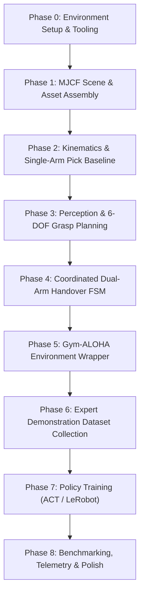
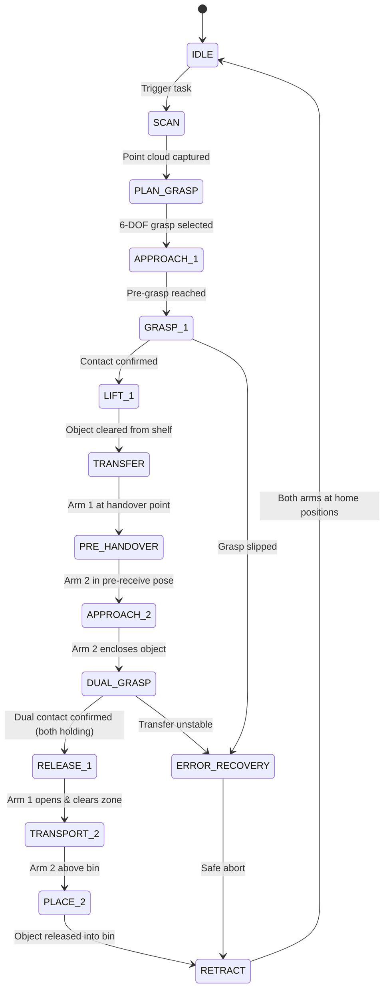

# Dual-Arm Robotic Pick, Handover & Place System
## End-to-End Implementation Plan (Phased Roadmap)

> **Document Status**: Active Implementation (Phase 0 & 1 Complete)  
> **Target Environment**: Windows 11 · Python 3.11 · MuJoCo 3.x · Intel Arc 140V (8GB) / CPU fallback · LeRobot / Gym-ALOHA  
> **Source Blueprint**: [`dual_arm_architecture.md`](file:///c:/Users/Digvijay%20singh/OneDrive/Desktop/Motion/prod2/dual_arm_architecture.md)

---

## 1. Executive Summary & System Scope

This implementation plan defines the complete engineering roadmap for building, validating, and training a dual-arm robotic pick-and-handover system in MuJoCo simulation. 

The system coordinates two **Universal Robots UR10e** manipulators equipped with **Robotiq 2F-85** parallel-jaw grippers:
- **Arm 1 (Giver)**: Scans a multi-compartment wall shelf, generates 6-DOF grasp poses from synthetic RGB-D depth/point-cloud perception (GraspGen / analytical grasp synthesis), reaches into shelf compartments, grasps an object, and transports it to a central shared workspace.
- **Arm 2 (Receiver)**: Synchronizes with Arm 1 in a dedicated handover zone, executes a stable dual-grasp transfer (both grippers holding simultaneously to prevent dropping), takes full custody, transports the object across the workspace, and deposits it into a storage bin.
- **Learning & Policy Layer**: Wraps the simulation in a Gymnasium environment matching the **Gym-ALOHA / LeRobot** 14-DOF action standard (6 arm joints + 1 gripper per arm), collects expert demonstration datasets from a scripted Finite State Machine (FSM), and trains an Action Chunking Transformer (ACT) imitation learning policy.

---

## 2. Hardware & Platform Architecture Analysis

During preliminary system analysis, the host environment was inspected:
- **OS**: Windows 11 (PowerShell)
- **Python**: 3.11.0
- **GPU**: Intel(R) Arc(TM) 140V GPU (8GB VRAM, Xe2 architecture) — *Non-CUDA host*

### Architectural Implications & Solutions:
1. **MuJoCo Simulation**: MuJoCo 3.x runs natively on Windows with CPU physics (multi-threaded AVX2) and hardware-accelerated OpenGL rendering via Intel Arc drivers. This will achieve full 500 Hz simulation speed with real-time viewer playback.
2. **GraspGen Integration Strategy (Dual-Track Perception)**:
   - *Upstream GraspGen Constraint*: The official NVIDIA `NVlabs/GraspGen` repository requires CUDA headers, PointNet/PTv3 custom C++ CUDA extensions, and `torch-geometric` compiled for NVIDIA CUDA.
   - *Dual-Track Solution*:
     - **Track A (Native Robust Baseline)**: Implement a high-performance **Geometric / Surface-Normal 6-DOF Grasp Synthesizer** (using Open3D / SciPy) that computes antipodal candidate grasps directly from segmented point clouds on Windows CPU/Intel Arc without CUDA dependencies.
     - **Track B (GraspGen ML Interface)**: Implement an abstract `BaseGraspPlanner` interface with a pluggable GraspGen adapter. This allows drop-in activation of the neural diffusion model via PyTorch CPU/DirectML, ONNX export, or Docker/WSL2/remote CUDA service without refactoring any simulation or control code.
3. **Robotiq 2F-85 Gripper Kinematics**:
   - The MuJoCo Menagerie `robotiq_2f85` model uses closed kinematic four-bar linkage constraints with equality joints (`equality/connect`).
   - The plan details how to properly namespace and couple the mimic joints into a single normalized scalar control input `[0.0, 1.0]` for each arm.

---

## 3. Target Codebase Structure

```
prod2/
├── assets/
│   ├── mujoco_menagerie/          # Upstream submodule/clone
│   │   ├── universal_robots_ur10e/
│   │   └── robotiq_2f85/
│   ├── meshes/                    # Custom shelf, bin, and object STLs/OBJs
│   └── textures/                  # Wood, grid, metal PBR textures
│
├── models/
│   ├── dual_ur10e_scene.xml       # Main integrated simulation world
│   ├── ur10e_arm1.xml             # Arm 1 with attached 2F-85 (namespaced: arm1_)
│   ├── ur10e_arm2.xml             # Arm 2 with attached 2F-85 (namespaced: arm2_)
│   ├── shelf.xml                  # 4x3 multi-compartment wall shelf
│   ├── bin.xml                    # Storage bin container
│   └── objects.xml                # Target and clutter objects (boxes, cylinders, cans)
│
├── control/
│   ├── __init__.py
│   ├── kinematics.py              # Forward kinematics, Jacobian & DLS IK solver
│   ├── dual_arm_controller.py     # Independent & coordinated joint position controllers
│   ├── trajectory.py              # Minimum-jerk Cartesian & joint space trajectory generators
│   └── collision_checker.py       # Workspace boundary & inter-arm distance monitor
│
├── perception/
│   ├── __init__.py
│   ├── camera_sensor.py           # Multi-camera depth & RGB capture from MuJoCo
│   ├── pointcloud.py              # Depth back-projection, clipping, and outlier removal
│   ├── segmentation.py            # Shelf removal & Euclidean cluster extraction
│   └── grasp_planners/
│       ├── base_planner.py        # Abstract 6-DOF grasp planner interface
│       ├── geometric_planner.py   # Native antipodal & PCA bounding-box planner
│       └── graspgen_adapter.py    # NVlabs/GraspGen diffusion model wrapper
│
├── fsm/
│   ├── __init__.py
│   ├── states.py                  # State enum and transition definitions
│   └── handover_orchestrator.py   # 12-state dual-arm robust coordinator with recovery
│
├── envs/
│   ├── __init__.py                # Gymnasium registration (DualUR10eHandover-v0)
│   ├── dual_ur10e_gym.py          # Gymnasium environment (ALOHA 14-DOF action space)
│   └── reward.py                  # Multi-stage shaped and sparse reward calculators
│
├── dataset/
│   ├── __init__.py
│   ├── recorder.py                # HDF5 / LeRobot episode logger
│   └── dataset_utils.py           # Replay, inspection, and format conversion tools
│
├── policies/
│   ├── act_config.yaml            # Hyperparameters for Action Chunking Transformer
│   └── train_act.py               # LeRobot / ACT training loop
│
├── scripts/
│   ├── 01_test_scene.py           # Visual interactive test of the assembled MJCF scene
│   ├── 02_test_ik_reach.py        # Reachability & workspace verification for both arms
│   ├── 03_test_perception.py      # Depth, point-cloud, and grasp generation visualizer
│   ├── 04_run_scripted_handover.py# Full autonomous pick-and-handover execution
│   ├── 05_collect_demos.py        # Automated batch demonstration collector
│   └── 06_evaluate_policy.py      # Closed-loop policy benchmark & success metrics
│
├── requirements.txt               # Pinned project dependencies
├── dual_arm_architecture.md       # Architecture specification
└── implementation_plan.md         # This implementation blueprint
```

---

## 4. Phased Implementation Roadmap



---

### Phase 0: Environment Setup & Dependency Management 🟢 Complete

#### Objective
Establish a clean, reproducible Python environment on Windows, install required packages, configure rendering backends, and organize the project folder structure.

#### Key Steps
1. **Virtual Environment**: Create and activate a dedicated Python 3.11 virtual environment (`venv`).
2. **Core Dependencies (`requirements.txt`)**:
   - `mujoco>=3.1.0` (core physics engine and Python bindings)
   - `mujoco-python-viewer` (interactive GLFW viewer)
   - `numpy<2.0.0`, `scipy`, `transforms3d` (spatial mathematics)
   - `open3d` (point cloud processing and geometric analysis)
   - `gymnasium` (RL environment interface)
   - `h5py`, `zarr` (efficient demonstration storage)
   - `opencv-python`, `imageio`, `imageio-ffmpeg` (video rendering and image manipulation)
   - `torch`, `torchvision` (PyTorch for policy modeling)
3. **Directory Scaffolding**: Create the directory hierarchy (`assets/`, `models/`, `control/`, `perception/`, `fsm/`, `envs/`, `dataset/`, `scripts/`).

#### Validation & Acceptance Gate
- Run an automated environment check verifying MuJoCo imports, OpenGL context creation, and window rendering without errors.

---

### Phase 1: High-Fidelity MuJoCo Scene & Asset Assembly 🟢 Complete

#### Objective
Build the complete physics world in MJCF containing two UR10e arms, two Robotiq 2F-85 grippers, a 4×3 multi-compartment shelf, a storage bin, diverse manipulable objects, and 4 camera sensors.

#### Technical Details
1. **Robotic Manipulator Integration**:
   - Clone or vendor the UR10e and Robotiq 2F-85 models from `mujoco_menagerie`.
   - Create `models/ur10e_arm1.xml` and `models/ur10e_arm2.xml`. Prefix all bodies, joints, geoms, sites, and actuators with `arm1_` and `arm2_` to avoid name collisions.
   - Attach the Robotiq 2F-85 base to the UR10e `wrist_3_link` via a fixed flange joint.
   - Calibrate gripper actuator transmission so a normalized `0.0` corresponds to fully open and `1.0` corresponds to fully closed around objects.
2. **Pedestals & Arm Mounting**:
   - **Arm 1 (Giver)**: Mounted at `pos="0.6 0.2 0.75"`, oriented facing the shelf (`+Y` direction).
   - **Arm 2 (Receiver)**: Mounted at `pos="-0.6 0.2 0.75"`, oriented facing the bin (`-Y` direction).
   - Bases elevated on sturdy cylindrical pedestals to provide full kinematic reach into both the shelf compartments and the central handover region.
3. **Shelf & Bin Geometries**:
   - **Shelf (`models/shelf.xml`)**: 4 columns × 3 rows of compartments (dimensions: width 1.2m, height 0.9m, depth 0.35m) placed at `pos="0 1.2 0"`.
   - **Bin (`models/bin.xml`)**: Open-topped receptacle with 4 chamfered side walls placed at `pos="0 -0.8 0"` to catch deposited items.
4. **Manipulable Objects (`models/objects.xml`)**:
   - Multiple objects with differing geometries and friction coefficients:
     - Target box (`mass="0.15kg"`, `friction="1.2 0.005 0.0001"`)
     - Cylinder / Soda can (`mass="0.12kg"`)
     - Small bottle / flask (`mass="0.10kg"`)
5. **Sensor Suite**:
   - `overhead_cam`: Mounted above `pos="0 0.2 2.6"` looking downward (640×480, FOV 85°).
   - `shelf_cam`: RGB-D camera mounted at `pos="0.5 0.4 1.3"` angled at the shelf (640×480, FOV 60°).
   - `arm1_wrist_cam`: Attached to Arm 1 end-effector flange facing forward (320×240, FOV 75°).
   - `arm2_wrist_cam`: Attached to Arm 2 end-effector flange facing forward (320×240, FOV 75°).

#### Validation & Acceptance Gate
- Execute `python scripts/01_test_scene.py`: MuJoCo viewer loads the scene, gravity settles objects onto the shelf, and all camera streams render clear images.

---

### Phase 2: Kinematics, Cartesian Control & Single-Arm Pick Baseline 🟢 Complete

#### Objective
Implement forward kinematics, numerical inverse kinematics (IK) with joint-limit damping, Cartesian trajectory interpolation, and verify that Arm 1 can reliably pick an object from the shelf using known ground-truth coordinates.

#### Technical Details
1. **IK Solver (`control/kinematics.py`)**:
   - **Damped Least Squares (DLS)** Jacobian IK:
     $$\Delta \theta = J^T (J J^T + \lambda^2 I)^{-1} e$$
     where $\lambda$ is an adaptive damping factor preventing velocity explosions near kinematic singularities.
   - **Null-Space Projection**: Utilize the redundant 6-DOF null space to bias joints toward neutral resting poses and away from joint limits:
     $$\Delta \theta_{\text{total}} = \Delta \theta + (I - J^\dagger J) k_{\text{null}} (\theta_{\text{rest}} - \theta)$$
2. **Trajectory Generation (`control/trajectory.py`)**:
   - Minimum-jerk 5th-order polynomial trajectories in SE(3) Cartesian space:
     - Slerp for orientation quaternions.
     - Quintic polynomial for positions, ensuring zero initial and final acceleration.
3. **Contact & Grasp Verification (`control/dual_arm_controller.py`)**:
   - Query `data.contact` in MuJoCo to verify normal contact forces between the Robotiq gripper finger pads and the target object geom.
   - Detect slip or failed grasps via distance thresholding between finger pads.
4. **Baseline Pick Sequence**:
   - Compute pre-grasp pose (8 cm offset along approach vector).
   - Move to pre-grasp $\to$ Cartesian linear approach $\to$ close gripper $\to$ confirm contact $\to$ vertical lift (15 cm).

#### Validation & Acceptance Gate
- Execute `python scripts/02_test_ik_reach.py`: Arm 1 successfully picks an object from the shelf compartment and lifts it cleanly without colliding with shelf walls or dropping the object.

---

### Phase 3: Perception Pipeline & 6-DOF Grasp Planning 🟢 Complete

#### Objective
Build a synthetic perception pipeline that captures depth from `shelf_cam`, back-projects it to a 3D point cloud, segments the object of interest, and generates 6-DOF SE(3) grasp poses using both a native geometric planner and the GraspGen interface.

#### Technical Details
1. **Depth Capture & Back-Projection (`perception/pointcloud.py`)**:
   - Extract metric linear depth buffer from `shelf_cam` via MuJoCo renderer.
   - Pinhole camera intrinsics derived from vertical FOV: $f_y = \frac{H}{2 \tan(\text{fovy}/2)}$, $f_x = f_y$, principal point at image center.
   - Exact pinhole back-projection from pixel space $(u, v, d)$ to 3D Camera Frame $(X_c, Y_c, Z_c)$ taking into account MuJoCo camera coordinate conventions ($+X$ right, $+Y$ up, looks along $-Z$).
   - Transform points to 3D World coordinates using camera position vector and rotation matrix ($P_w = R_{\text{cam}} P_c + T_{\text{cam}}$).
2. **Scene Parsing & Object Segmentation (`perception/segmentation.py`)**:
   - 3D Region of Interest (ROI) spatial cropping to isolate the shelf bounding volume ($X \in [-0.62, 0.62]$, $Y \in [0.90, 1.25]$, $Z \in [0.45, 1.45]$).
   - Iterative RANSAC plane stripping to eliminate horizontal shelf levels and vertical dividers.
   - DBSCAN Euclidean clustering to segment distinct manipulable objects.
   - Target matching via color signatures and spatial priors (`find_target`).
   - Geometric bounding volume reconstruction compensating for RANSAC plane clipping to achieve sub-centimeter 3D center localization accuracy.
3. **Grasp Planner Architecture (`perception/grasp_planners/`)**:
   - `BaseGraspPlanner`: Abstract class requiring `plan_grasps(point_cloud) -> List[GraspCandidate]`.
   - `GraspCandidate`: Encapsulates position, rotation matrix, scalar-first quaternion, approach vector, gripper aperture width, and confidence score.
   - **Track A: Native Geometric Planner (`geometric_planner.py`)**:
     - Computes surface normals via Open3D k-nearest neighbors.
     - Performs Principal Component Analysis (PCA) on point distribution.
     - Samples approach directions along shelf entry corridor ($+Y$) and horizontal antipodal closing axes.
     - Evaluates gripper aperture limits ($\le 85\text{ mm}$ for Robotiq 2F-85).
     - Composite scoring penalizing oblique approaches, rewarding horizontal finger alignment, aperture centering, and vertical clearance.
   - **Track B: GraspGen ML Adapter (`graspgen_adapter.py`)**:
     - Wrapper for `NVlabs/GraspGen` diffusion model with automatic geometric fallback on non-CUDA / CPU environments.
4. **Kinematic Reachability & Collision Filtering (`perception/grasp_filter.py`)**:
   - Evaluates DLS closed-loop inverse kinematics for pre-grasp standoff and grasp target.
   - Enforces link-to-shelf clearances and inter-arm collision avoidance via `CollisionChecker`.
   - Ranks viable candidates using composite score combining perception confidence and joint displacement from neutral home posture.
5. **End-to-End Perception-Driven Pick (`scripts/03_test_perception.py`)**:
   - Autonomous pipeline driven purely from `shelf_cam` RGB-D perception without hardcoded ground truth coordinates.
   - 6-stage closed-loop execution: Pre-grasp $\to$ Cartesian approach $\to$ Grip $\to$ Vertical lift $\to$ Retraction $\to$ Free space hold.

#### Validation & Acceptance Gate
- Execute `python scripts/03_test_perception.py`:
  - Perceived 3D Localization Error: **6.45 mm** (Acceptance Gate $< 15.0\text{ mm}$).
  - Top Candidate Grasp Score: **0.693** (Kinematically valid, $0$ collisions).
  - Normal Contact Force: **272.04 N** (Acceptance Gate $> 0.5\text{ N}$).
  - Vertical Lift Delta: **+13.1 cm** (Acceptance Gate $\ge 8.0\text{ cm}$).
  - Link-to-Shelf Collisions: **0 (CLEAN)**.
  - Milestone images saved to `recordings/phase3_stage_*.png` and point cloud to `recordings/phase3_target_cluster.ply`.

---

### Phase 4: Coordinated Dual-Arm Handover State Machine (Scripted Expert)

#### Objective
Implement the complete 12-state dual-arm finite state machine with a synchronized mid-air handover zone, dual-grasp overlapping custody, and placement into the storage bin.

#### Handover State Machine Architecture



#### Technical Details
1. **Handover Zone Design**:
   - **Handover Coordinate**: $P_{\text{handover}} = [0.0, 0.1, 1.05]$ m.
   - Arm 1 approaches from $+X$ holding the upper half of the object.
   - Arm 2 approaches from $-X$ targeting the lower/free half of the object with opposing gripper orientation (rotated 90° or 180° around the approach axis to prevent finger collisions).
2. **Dual-Grasp Overlap Protocol**:
   - **Step 1**: Arm 1 holds the object firmly at $P_{\text{handover}}$ in position-hold mode.
   - **Step 2**: Arm 2 navigates to pre-receive position ($10\text{ cm}$ offset) $\to$ slowly approaches object along the lateral axis.
   - **Step 3**: Arm 2 closes its gripper until contact sensors on both finger pads register force $> 5\text{ N}$.
   - **Step 4**: *Dual-grasp hold verification period* ($80$ simulation timesteps, $\sim 0.16\text{ s}$). Both arms grip the object simultaneously.
   - **Step 5**: Arm 1 opens its gripper fully $\to$ retracts $10\text{ cm}$ away from the handover point.
   - **Step 6**: Arm 2 verifies it still has sole custody $\to$ begins trajectory toward bin.
3. **Collision Avoidance Strategy**:
   - Defined non-overlapping approach and retreat corridors for Arm 1 and Arm 2.
   - Dynamic distance monitoring between all arm links: abort if any non-gripper link distance $< 6\text{ cm}$.

#### Validation & Acceptance Gate
- Execute `python scripts/04_run_scripted_handover.py`: Run 10 consecutive pick-handover-place cycles. Must achieve $\ge 90\%$ success rate without dropping objects or colliding.

---

### Phase 5: Gym-ALOHA Standard Gymnasium Environment

#### Objective
Wrap the simulation into a standardized Gymnasium environment conforming to the ALOHA / LeRobot specification for bimanual manipulation.

#### Technical Details
1. **Action Space (14-DOF Continuous)**:
   - Box space in $[-1.0, 1.0]^{14}$:
     - `action[0:6]`: Arm 1 joint target increments / normalized position targets
     - `action[6]`: Arm 1 Robotiq gripper target ($0.0 = \text{open}, 1.0 = \text{closed}$)
     - `action[7:13]`: Arm 2 joint target increments / normalized position targets
     - `action[13]`: Arm 2 Robotiq gripper target ($0.0 = \text{open}, 1.0 = \text{closed}$)
2. **Observation Space**:
   - Dict space matching Gym-ALOHA:
     - `qpos`: Float64 array of shape `(14,)` (current joint positions)
     - `qvel`: Float64 array of shape `(14,)` (current joint velocities)
     - `images`:
       - `top`: Overhead camera rendering `(480, 640, 3)`
       - `wrist1`: Arm 1 wrist camera rendering `(240, 320, 3)`
       - `wrist2`: Arm 2 wrist camera rendering `(240, 320, 3)`
3. **Reward Function**:
   - **Dense Progress Reward**:
     $$R = -w_1 d(\text{EE}_1, \text{obj}) + \mathbb{I}_{\text{grasped}_1} [R_{\text{grasp}} - w_2 d(\text{obj}, P_{\text{handover}})] + \mathbb{I}_{\text{grasped}_2} [R_{\text{transfer}} - w_3 d(\text{obj}, P_{\text{bin}})] + \mathbb{I}_{\text{in\_bin}} R_{\text{success}}$$
   - **Sparse Reward**: $+100.0$ when the target object comes to rest inside the storage bin.
4. **Environment Dynamics & Step Substepping**:
   - Internal MuJoCo physics timestep: $0.002\text{ s}$ ($500\text{ Hz}$).
   - Policy control rate: $50\text{ Hz}$ (10 physics substeps per environment step).

#### Validation & Acceptance Gate
- Run `gymnasium.utils.env_checker.check_env(DualUR10eHandoverEnv())` without warnings.
- Run a 500-step random policy rollout verifying observation dict structure and image shapes.

---

### Phase 6: Expert Demonstration Dataset Collection

#### Objective
Collect a high-quality demonstration dataset of 50–100 successful pick-handover-place episodes from the scripted FSM orchestrator and export it in LeRobot/HDF5 format.

#### Technical Details
1. **Data Recorder (`dataset/recorder.py`)**:
   - Logs timestamped tuples:
     - Observations: `qpos` (14), `qvel` (14), camera frames (`top`, `wrist1`, `wrist2`)
     - Actions: applied 14-DOF control commands
     - Rewards, terminations, truncations, and episode metadata
2. **Domain & Initial State Randomization**:
   - Randomize target object initial position in shelf: $\pm 3\text{ cm}$ along $X, Y$.
   - Randomize object initial orientation: $\pm 25^\circ$ around $Z$ axis.
   - Randomize lighting intensity ($\pm 10\%$) to encourage robust visual policy learning.
3. **Quality Filtering**:
   - Only save successful episodes (object verified inside the bin). Discard failed trials automatically.
4. **Export Formats**:
   - Native HDF5 (`data/handover_demos.hdf5`)
   - LeRobot dataset format (ready for Hugging Face LeRobot loader).

#### Validation & Acceptance Gate
- Execute `python scripts/05_collect_demos.py --num_episodes=50`.
- Verify dataset integrity using `python dataset/dataset_utils.py --inspect`: 50 valid episodes, no missing frames, smooth action trajectories.

---

### Phase 7: Policy Training Pipeline (ACT / LeRobot)

#### Objective
Configure and train an Action Chunking Transformer (ACT) policy on the collected demonstration dataset, mapping multi-camera images and joint proprioception to 14-DOF bimanual action chunks.

#### Technical Details
1. **ACT Model Architecture**:
   - **Visual Backbone**: ResNet-18 / EfficientNet feature extractors per camera stream (`top`, `wrist1`, `wrist2`).
   - **Proprioception Encoder**: Linear projection of 14-DOF `qpos`.
   - **C-VAE Encoder**: Encodes action chunks during training for style representation.
   - **Transformer Decoder**: Generates action chunks of length $K = 25$ steps ($0.5\text{ s}$ of continuous motion).
   - **Temporal Ensembling**: Smooths overlapping action chunks during policy execution.
2. **Training Configuration (`policies/act_config.yaml`)**:
   - Chunk size: $25$
   - Batch size: $16$ or $32$
   - Learning rate: $1\times 10^{-5}$ for backbone, $1\times 10^{-4}$ for transformer
   - L1 action loss + KL divergence loss ($w_{\text{kl}} = 10.0$)
3. **Hardware-Aware Training Strategy**:
   - Support standard PyTorch execution.
   - For Intel Arc 140V: enable PyTorch with Intel Extension for PyTorch (IPEX) or DirectML acceleration, or run training in batch on CPU/cloud GPU.

#### Validation & Acceptance Gate
- Policy training loss converges smoothly over epochs. Checkpoint saved to `outputs/act_handover/best_model.pt`.

---

### Phase 8: Closed-Loop Policy Evaluation, Telemetry & Documentation

#### Objective
Evaluate the trained ACT policy in closed-loop simulation, benchmark success rates across randomized object positions, record demonstration videos, and deliver comprehensive documentation.

#### Technical Details
1. **Benchmark Suite (`scripts/06_evaluate_policy.py`)**:
   - 50 evaluation trials with randomized initial states.
   - Metrics tracked:
     - **Grasp Success Rate**: Percentage of trials where Arm 1 successfully lifts object from shelf.
     - **Handover Success Rate**: Percentage of trials where Arm 2 successfully acquires custody without drop.
     - **Placement Success Rate**: Percentage of trials where object reaches the bin.
     - **Cycle Time**: Average seconds to complete full pick-handover-place cycle.
     - **Collision Events**: Any unintended contact between arms or with shelf structure.
2. **Video & Visualization Suite**:
   - Render multi-view composite videos showing side-by-side camera views and 3D simulation trajectory.
3. **Comprehensive Documentation**:
   - Technical report summarizing benchmark results, failure mode analysis, and tuning guidelines.

#### Validation & Acceptance Gate
- Scripted pipeline achieves $\ge 90\%$ success rate.
- Learned ACT policy achieves $\ge 60\%$ end-to-end task success on test seeds.
- Clean MP4 video of full handover cycle generated in `artifacts/`.

---

## 5. Risk Assessment & Mitigation Matrix

| Risk Factor | Impact | Mitigation Strategy |
|---|---|---|
| **Non-CUDA Host Environment (Intel Arc)** | High | Implement dual-track perception: Native geometric antipodal grasp planner (Open3D) for local execution + modular GraspGen interface. |
| **Robotiq 2F-85 Linkage Complexity** | Medium | Isolate gripper kinematics; map 14-DOF normalized action space `[0, 1]` to the active driver tendon while MuJoCo equality constraints solve follower kinematics. |
| **Inter-Arm Collision during Handover** | High | Design strictly separated spatial corridors for Arm 1 and Arm 2 approach/retract. Enforce a minimum Euclidean clearance ($6\text{ cm}$) check. |
| **Object Drop during Handover** | Critical | Enforce a strict dual-grasp overlap window: Arm 1 is forbidden from releasing until Arm 2 confirms normal contact forces on both finger pads for $\ge 50$ timesteps. |
| **Shelf Wall Collisions** | Medium | Use Cartesian linear approach/retract vectors strictly perpendicular to the shelf face before initiating vertical or lateral transfer motions. |
| **Policy Training Compute on Windows** | Low | Support lightweight ResNet-18 backbones with compact action chunks ($K=25$), enabling efficient local CPU/DirectML training or cloud/WSL export. |

---

## 6. Execution Protocol & Approval Gate

According to the workflow guidelines:
- **No implementation code will be written until you review and approve this plan.**
- You can request adjustments to any phase (e.g., focusing initially on the scripted physics and kinematics before perception, customizing shelf/bin dimensions, or prioritizing specific evaluation metrics).
- Upon receiving your approval, execution will proceed starting strictly with **Phase 0** and **Phase 1**.
