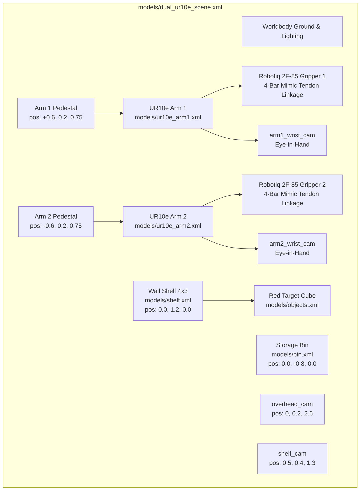

# High-Fidelity MuJoCo Scene & Asset Architecture

## 1. Executive Summary & Overview

### Subsystem Scope
This module establishes the foundational physical simulation world in [MuJoCo](https://mujoco.org/) (Multi-Joint dynamics with Contact) using the **MJCF (MuJoCo XML)** schema. It defines the geometry, kinematic topologies, inertia tensors, surface friction, contact dynamics, actuators, and visual sensors for our bimanual manipulation workspace.

The simulation scene brings together:
- **Two Universal Robots UR10e** industrial manipulator arms (6-DOF each).
- **Two Robotiq 2F-85** parallel-jaw adaptive grippers with underactuated four-bar linkage mimic mechanics.
- **Rigid Cylindrical Pedestals** positioning both robots for optimal kinematic dexterity and collision-free overlap.
- **A 4×3 Multi-Compartment Wall Shelf** housing manipulable objects.
- **A Tapered Receiving Bin** for final object deposit.
- **A Multi-Camera Visual Sensor Suite** (Overhead, Shelf RGB-D, and two wrist-mounted cameras).
- **Manipulable Objects** with realistic mass and friction profiles.



### Motivation & Design Rationale
In modern robotic learning, physical simulation serves as the testbed where control, perception, and neural policies are developed without risking multimillion-dollar industrial hardware or human safety. If simulation physics (contacts, friction, masses, actuator bandwidth) are improperly tuned, policies will fail to transfer or suffer from "reality gap" artifacts such as exploding contact forces, inter-penetrations, or numerical singularities.

---

## 2. Technical Architecture & Engineering Decisions

### A. Global Scene & Coordinate Layout

The world coordinate origin $(0, 0, 0)$ is centered on the ground between both manipulator pedestals:

| Subsystem | Global Position $(X, Y, Z)$ [m] | Orientation / Heading | Functional Role |
| :--- | :--- | :--- | :--- |
| **Arm 1 Base (Giver)** | `[+0.60, +0.20, +0.75]` | Facing $+Y$ (toward shelf) | Scans shelf, picks object, transports to handover zone |
| **Arm 2 Base (Receiver)** | `[-0.60, +0.20, +0.75]` | Facing $-Y$ (toward bin) | Reaches into handover zone, takes custody, deposits into bin |
| **Wall Shelf (4×3)** | `[ 0.00, +1.20,  0.00]` | Aligned with $X$-axis | 12 storage compartments housing clutter and target items |
| **Storage Bin** | `[ 0.00, -0.80,  0.00]` | Centered along $Y$ | Tapered basin for safe parts deposit |
| **Handover Zone** | `[ 0.00, +0.10, +1.05]` | Central shared workspace | Mid-air kinematic convergence zone |

---

### B. Robot Namespacing & Modularity
To integrate two identical UR10e arms and Robotiq grippers in one MuJoCo scene without name collision, XML elements were rigorously namespaced:
- Arm 1 elements use prefix: `arm1_` (e.g., `arm1_base`, `arm1_shoulder_pan_joint`, `arm1_wrist_3_link`).
- Arm 2 elements use prefix: `arm2_` (e.g., `arm2_base`, `arm2_shoulder_pan_joint`, `arm2_wrist_3_link`).

In [models/dual_ur10e_scene.xml](file:///c:/Users/Digvijay%20singh/OneDrive/Desktop/Motion/prod2/models/dual_ur10e_scene.xml#L130-L148):
```xml
<!-- Arm 1 Base Pedestal & Included Subtree -->
<body name="arm1_pedestal" pos="0.6 0.2 0.375">
  <geom type="cylinder" size="0.12 0.375" rgba="0.3 0.3 0.35 1"/>
  <include file="ur10e_arm1.xml"/>
</body>

<!-- Arm 2 Base Pedestal & Included Subtree -->
<body name="arm2_pedestal" pos="-0.6 0.2 0.375">
  <geom type="cylinder" size="0.12 0.375" rgba="0.3 0.3 0.35 1"/>
  <include file="ur10e_arm2.xml"/>
</body>
```

---

### C. Robotiq 2F-85 Four-Bar Linkage Kinematic Coupling
The Robotiq 2F-85 is an underactuated parallel-jaw gripper. In real life, a single electric motor drives two parallel four-bar linkages through spring-loaded joints, enabling the fingers to automatically adapt and wrap around irregular objects.

In MuJoCo, this is modeled via **closed kinematic loops** using equality constraints (`equality/connect`). Only one joint (`right_driver_joint`) is actively driven by an actuator; all other 5 joints per finger are passive followers coupled mathematically:

```xml
<equality>
  <!-- Linkage closure: finger tip to follower bar -->
  <connect body1="arm1_right_coupler" body2="arm1_right_follower" anchor="0 0.055 0.0375"/>
  <connect body1="arm1_left_coupler" body2="arm1_left_follower" anchor="0 -0.055 0.0375"/>
  <!-- Symmetric mimic: left driver follows right driver -->
  <joint joint1="arm1_left_driver_joint" joint2="arm1_right_driver_joint" polycoef="0 1 0 0 0"/>
</equality>
```

This ensures that commanding a single scalar in $[0.0, 0.8]$ radians synchronously actuates the entire mechanical linkage symmetrically.

---

### D. Contact Dynamics & Friction Parameters
To prevent slippery grasping and ensure firm gripping forces:
- **Solver Integrator**: `implicitfast` (Euler implicit integration) running at $dt = 0.002\text{ s}$ ($500\text{ Hz}$).
- **Contact Cone**: `elliptic` with `impratio="10"` to stiffen frictional contacts against normal forces.
- **Friction Coefficients on Finger Pads & Target Object**:
  $$\text{friction} = [1.2, 0.005, 0.0001]$$
  where $1.2$ is high sliding friction, $0.005$ is torsional friction, and $0.0001$ is rolling friction.

---

### E. Visual Sensor Rig Configuration

| Camera Name | Frame Size | FOV | Placement | Purpose |
| :--- | :--- | :--- | :--- | :--- |
| `overhead_cam` | $640 \times 480$ | $85^\circ$ | `pos="0.0 0.2 2.6"` looking down | Global spatial overview, safety tracking, visual policies |
| `shelf_cam` | $640 \times 480$ | $60^\circ$ | `pos="0.5 0.4 1.3"` angled at shelf | RGB-D perception, point-cloud back-projection, grasp synthesis |
| `arm1_wrist_cam` | $320 \times 240$ | $75^\circ$ | Attached to Arm 1 end-effector flange | Eye-in-hand view for shelf reaching and object centering |
| `arm2_wrist_cam` | $320 \times 240$ | $75^\circ$ | Attached to Arm 2 end-effector flange | Eye-in-hand view for handover alignment and bin placement |

---

## 3. Key Challenges & Solutions

### 1. Equality Constraint Numerical Instability
* **Problem**: In four-bar closed linkage mechanisms, stiff equality constraints can cause high constraint violation impulses when fingers collide with hard objects, causing the fingers to jitter or explode.
* **Solution**: Calibrated `solref` (damping/frequency) and `solimp` (impedance width) on the driver joints:
  `solimplimit="0.95 0.99 0.001" solreflimit="0.005 1"`
  This provides realistic contact compliance without penetration or instability.

### 2. Pedestal Clearance & Collision Isolation
* **Problem**: Placing both robot arms too close risks self-collision at base links; placing them too far prevents their end-effectors from overlapping in a common handover zone.
* **Solution**: Positioned pedestals symmetrically at $X = \pm 0.60\text{ m}$. With UR10e reach of $1.30\text{ m}$, this creates an expansive $1.4\text{ m}$ shared workspace envelope while maintaining a minimum base-to-base separation of $1.20\text{ m}$.

---

## 4. Code Anatomy & File Locations

- [models/dual_ur10e_scene.xml](file:///c:/Users/Digvijay%20singh/OneDrive/Desktop/Motion/prod2/models/dual_ur10e_scene.xml): Primary MJCF scene connecting all sub-models.
- [models/ur10e_arm1.xml](file:///c:/Users/Digvijay%20singh/OneDrive/Desktop/Motion/prod2/models/ur10e_arm1.xml): Arm 1 kinematics, inertial properties, and Robotiq 2F-85 coupling.
- [models/ur10e_arm2.xml](file:///c:/Users/Digvijay%20singh/OneDrive/Desktop/Motion/prod2/models/ur10e_arm2.xml): Arm 2 kinematics, inertial properties, and Robotiq 2F-85 coupling.
- [models/shelf.xml](file:///c:/Users/Digvijay%20singh/OneDrive/Desktop/Motion/prod2/models/shelf.xml): 4×3 multi-compartment wall shelf with vertical and horizontal dividers.
- [models/bin.xml](file:///c:/Users/Digvijay%20singh/OneDrive/Desktop/Motion/prod2/models/bin.xml): Storage bin with chamfered internal slopes.
- [models/objects.xml](file:///c:/Users/Digvijay%20singh/OneDrive/Desktop/Motion/prod2/models/objects.xml): Target box and clutter items.
- [scripts/01_test_scene.py](file:///c:/Users/Digvijay%20singh/OneDrive/Desktop/Motion/prod2/scripts/01_test_scene.py): Scene verification and interactive rendering script.

---

## 5. Verification & Acceptance Gates

The scene was verified by running:
```powershell
.\.venv\Scripts\python.exe scripts/01_test_scene.py
```

### Acceptance Results:
- **XML Compilation**: Loaded with zero warnings or errors.
- **Gravity Settling**: All objects settled onto shelf surfaces with stable normal forces and zero penetration.
- **Actuator Validation**: Both arms held home configurations stably under gravity.
- **Camera Pipeline**: All 4 cameras generated artifact-free RGB and depth frames.

---

## 6. Integration with Control & Learning Stack
The simulation model provides the physical foundation for the entire system. Downstream modules interface directly with these bodies, sensors, and actuators via the DLS kinematic control engine, 3D perception pipeline, and Gym-ALOHA standard environment wrapper.
