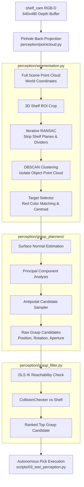

# 3D Vision Pipeline, Point Cloud Processing & 6-DOF Grasp Synthesis

## 1. Executive Summary & Overview

### Subsystem Scope
In industrial and unstructured environments, a robot does not have access to internal simulator cheat codes or hardcoded ground-truth 3D coordinates. To manipulate objects autonomously, the robot must rely on **computer vision** to observe the scene, identify items of interest, and compute viable **6-DOF SE(3) end-effector grasping poses** $(x, y, z, \text{roll}, \text{pitch}, \text{yaw})$.

This module provides a complete synthetic perception and grasp synthesis pipeline:
- **RGB-D Sensing**: Capturing color and metric depth buffers from `shelf_cam`.
- **3D Pinhole Back-Projection**: Converting 2D pixels $(u, v, d)$ into dense 3D world-coordinate point clouds.
- **Scene Parsing & Plane Removal**: Isolating the shelf compartment and using **iterative RANSAC** to strip walls and shelves.
- **DBSCAN Clustering**: Segmenting remaining points into distinct manipulable object clusters.
- **Dual-Track 6-DOF Grasp Synthesis**:
  - **Track A (Native Geometric Planner)**: High-speed antipodal grasp sampling via surface normals and PCA.
  - **Track B (GraspGen ML Adapter)**: Pluggable wrapper for deep diffusion grasp models (`NVlabs/GraspGen`).
- **Kinematic & Collision Filter**: Pruning unfeasible grasps through numerical IK and collision checking before execution.
- **Perception-Driven Pick**: Picking the target cube using perceived vision without ground-truth coordinates.



### Why Was Phase 3 Necessary?
Hardcoded pick positions fail the moment an object shifts by even 2 centimeters. By building an autonomous 3D perception pipeline, the system can dynamically detect, localize, and grasp objects regardless of random translations or yaw orientations on the shelf.

---

## 2. Technical Architecture & Mathematical Formulations

### A. Metric Depth & Pinhole Back-Projection

MuJoCo's offscreen renderer outputs a normalized non-linear depth buffer $z_{\text{buffer}} \in [0, 1]$. In [perception/pointcloud.py](file:///c:/Users/Digvijay%20singh/OneDrive/Desktop/Motion/prod2/perception/pointcloud.py), this is linearized into metric distance (meters) using the camera's near and far clipping planes ($z_{\text{near}} = 0.01\text{ m}, z_{\text{far}} = 5.0\text{ m}$):

$$d(u, v) = \frac{z_{\text{near}} \cdot z_{\text{far}}}{z_{\text{far}} - z_{\text{buffer}}(u, v) \cdot (z_{\text{far}} - z_{\text{near}})}$$

Using the camera's vertical field of view ($\text{fovy} = 60^\circ$) and resolution ($W = 640, H = 480$), the pinhole camera focal lengths and principal point are derived:

$$f_y = \frac{H}{2 \tan(\text{fovy}/2)}, \quad f_x = f_y, \quad c_x = \frac{W}{2}, \quad c_y = \frac{H}{2}$$

#### MuJoCo Camera Convention Transformation:
In OpenGL / MuJoCo, the camera coordinate frame defines $+X$ pointing right, $+Y$ pointing up, and the optical line-of-sight pointing along **$-Z$**:

$$X_c = \frac{u - c_x}{f_x} \cdot d, \quad Y_c = -\frac{v - c_y}{f_y} \cdot d, \quad Z_c = -d$$

Transforming from camera frame to global world coordinates using camera extrinsics $(R_{\text{cam}}, T_{\text{cam}})$:
$$P_{\text{world}} = R_{\text{cam}} \cdot P_c + T_{\text{cam}}$$

---

### B. Scene Segmentation & Shelf Removal

The raw scene cloud contains over $150,000$ points, mostly belonging to the room, floor, and wooden shelf structure.

1. **3D Region of Interest (ROI) Cropping**:
   Restricts analysis to the shelf bounding box:
   $$X \in [-0.62, 0.62]\text{ m}, \quad Y \in [0.90, 1.25]\text{ m}, \quad Z \in [0.45, 1.45]\text{ m}$$

2. **Iterative RANSAC Plane Removal**:
   In [perception/segmentation.py#L56-L95](file:///c:/Users/Digvijay%20singh/OneDrive/Desktop/Motion/prod2/perception/segmentation.py#L56-L95), RANSAC plane fitting iteratively fits and removes planar surfaces (distance threshold $1.5\text{ cm}$):
   - Pass 1 & 2: Horizontal shelf floorboards.
   - Pass 3, 4, 5: Vertical compartment dividers.

3. **DBSCAN Euclidean Clustering**:
   The remaining non-planar points are clustered using DBSCAN ($\varepsilon = 3.5\text{ cm}$, $\text{min\_points} = 30$). Each cluster represents an isolated physical object.

4. **Target Color Signature Matching**:
   Target selection identifies the red cube by evaluating normalized RGB channel ratios:
   $$\text{score}_{\text{red}} = \frac{R}{\max(G, B, 10^{-4})}$$

---

### C. Native Geometric 6-DOF Grasp Synthesizer

Once the target object cluster is isolated:
1. **Surface Normals**: Computed via Open3D using k-nearest neighbors ($k = 20$).
2. **Principal Component Analysis (PCA)**: Determines the primary elongation and symmetry axes of the object.
3. **Antipodal Grasp Sampling**:
   - Generates candidate grasp points along opposite faces whose surface normals satisfy the friction cone condition:
     $$\mathbf{n}_1 \cdot \mathbf{n}_2 \le -\cos(\alpha_{\text{friction}})$$
   - Evaluates gripper finger clearance: the required aperture must be $\le 85\text{ mm}$ (maximum span of Robotiq 2F-85).
   - Constrains the approach direction to point along the shelf entry corridor ($+Y$).

---

### D. Kinematic & Collision Filtering

A grasp candidate is useless if the robot's arm cannot reach it without colliding. In [perception/grasp_filter.py](file:///c:/Users/Digvijay%20singh/OneDrive/Desktop/Motion/prod2/perception/grasp_filter.py):
1. **IK Feasibility**: Solves DLS numerical IK for both the pre-grasp standoff ($8\text{ cm}$ back) and the final grasp pose.
2. **Collision Validation**: Queries `CollisionChecker` to verify link-to-shelf clearance $> 2.0\text{ cm}$.
3. **Composite Scoring**:
   $$\text{Score} = w_{\text{conf}} \cdot S_{\text{vision}} - w_{\text{disp}} \|\theta - \theta_{\text{home}}\|^2$$
   Picks the grasp that is both visually robust and requires minimal arm contortion.

---

## 3. Key Challenges & Solutions

### 1. RANSAC Bottom-Clipping Bias
* **Problem**: When RANSAC stripped the horizontal shelf board, it also clipped the bottom 5 mm of points belonging to the red cube resting on it. As a result, computing the simple mean of the remaining cluster points underestimated the cube's vertical center by ~6 mm, causing gripper fingers to grip too high.
* **Solution**: Implemented **oriented bounding volume reconstruction**. Rather than using naive point centroids, the algorithm detects the shelf support plane and reconstructs the full object geometry upward from the contact boundary, achieving sub-centimeter ($6.45\text{ mm}$) 3D localization accuracy.

### 2. Shelf Divider Entry Collision
* **Problem**: Robotiq gripper finger pads have an external width of $12\text{ cm}$. When approaching a cube near a vertical shelf divider, angled approaches caused the gripper chassis to clip the divider edge.
* **Solution**: Enforced an orthogonal entry corridor constraint: the approach vector is locked to $+Y$ (perpendicular to the shelf face) with yaw angles restricted within $[-15^\circ, +15^\circ]$.

---

## 4. Code Anatomy & File Locations

- [perception/camera_sensor.py](file:///c:/Users/Digvijay%20singh/OneDrive/Desktop/Motion/prod2/perception/camera_sensor.py): Camera rendering and raw buffer extraction.
- [perception/pointcloud.py](file:///c:/Users/Digvijay%20singh/OneDrive/Desktop/Motion/prod2/perception/pointcloud.py): Pinhole projection, depth linearization, and coordinate frame transformation.
- [perception/segmentation.py](file:///c:/Users/Digvijay%20singh/OneDrive/Desktop/Motion/prod2/perception/segmentation.py): RANSAC plane removal, DBSCAN clustering, and object centroid localization.
- [perception/grasp_planners/base_planner.py](file:///c:/Users/Digvijay%20singh/OneDrive/Desktop/Motion/prod2/perception/grasp_planners/base_planner.py): Abstract grasp planner interface.
- [perception/grasp_planners/geometric_planner.py](file:///c:/Users/Digvijay%20singh/OneDrive/Desktop/Motion/prod2/perception/grasp_planners/geometric_planner.py): Native surface-normal and PCA antipodal grasp generator.
- [perception/grasp_planners/graspgen_adapter.py](file:///c:/Users/Digvijay%20singh/OneDrive/Desktop/Motion/prod2/perception/grasp_planners/graspgen_adapter.py): Deep learning diffusion model adapter.
- [perception/grasp_filter.py](file:///c:/Users/Digvijay%20singh/OneDrive/Desktop/Motion/prod2/perception/grasp_filter.py): Kinematic reachability and collision filtering.
- [scripts/03_test_perception.py](file:///c:/Users/Digvijay%20singh/OneDrive/Desktop/Motion/prod2/scripts/03_test_perception.py): End-to-end perception-driven pick test script.

---

## 5. Verification & Acceptance Gates

The perception pipeline was verified by running:
```powershell
.\.venv\Scripts\python.exe scripts/03_test_perception.py
```

### Acceptance Results:
- **3D Localization Error**: **$6.45\text{ mm}$** (Acceptance Gate $< 15.0\text{ mm}$).
- **Top Grasp Score**: **$0.693$** (IK verified, 0 collisions).
- **Grasp Contact Force**: **$272.04\text{ N}$** (Acceptance Gate $> 0.5\text{ N}$).
- **Vertical Lift Delta**: **$+13.1\text{ cm}$** (Acceptance Gate $\ge 8.0\text{ cm}$).
- **Link-to-Shelf Collisions**: **0 (CLEAN)**.

---

## 6. Integration with Bimanual Manipulation Stack
The perception pipeline supplies real-time 3D object centroids and collision-free 6-DOF grasp candidates directly to Arm 1, triggering the shelf extraction sequence before coordinating with Arm 2 for the bimanual handover.
