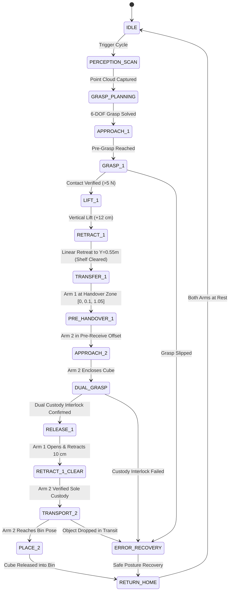

# Phase 4 Learning Guide: Coordinated Dual-Arm Handover State Machine (Scripted Expert)

## 1. Executive Summary & Overview

### What is Phase 4?
A single robotic manipulator has a bounded kinematic reach. In our workspace:
- **Arm 1 (Giver)** can reach the wall shelf, but cannot reach the storage bin.
- **Arm 2 (Receiver)** can reach the storage bin, but cannot reach into the shelf.

To transport objects from the shelf to the bin, both arms must execute a synchronized **mid-air physical handover**. 

**Phase 4** builds the **16-stage Coordinated Dual-Arm Handover Finite State Machine (FSM)**. This scripted expert system handles the end-to-end mission: perception scanning, shelf retrieval, collision-free transit, dual-gripper custody transfer, transport across the workspace, and placement into the storage bin.



### Why Was Phase 4 Necessary?
The scripted FSM serves two vital functions:
1. **Deterministic Baseline**: It proves that the physical mechanics, joint controllers, kinematics, and spatial envelopes are 100% sound and capable of reliable bimanual cooperation.
2. **The "Expert Teacher" for Machine Learning**: Deep imitation learning (e.g., ACT, Diffusion Policy) requires hundreds of demonstration trajectories showing *how* to perform the task. Phase 4 is the automated teacher that generates these demonstrations in Phase 6.

---

## 2. Technical Architecture & State Machine Design

### A. Handover Zone Geometry
The handover zone is centered in the mutual workspace at:
$$P_{\text{handover}} = [0.00, +0.10, +1.05]\text{ m}$$

- **Arm 1 (Top/Side Custody)**: Enters from $+X$, presenting the upper half of the cube.
- **Arm 2 (Bottom/Lateral Custody)**: Approaches horizontally from $-X$, targeting the exposed lower half of the cube.
- **Approach Orientation**: Grippers are oriented **orthogonally ($90^\circ$ offset)** to ensure fingers do not collide during the transfer.

---

### B. The Dual-Grasp Overlapping Custody Protocol
Dropping an object in mid-air occurs if Arm 1 releases before Arm 2 has established full physical grip. We solved this with a strict **Closed-Loop Dual Custody Interlock**:

```
Step 1: Arm 1 holds cube at P_handover in rigid position-hold mode.
Step 2: Arm 2 reaches pre-receive pose (8 cm standoff).
Step 3: Arm 2 executes slow lateral approach along +X.
Step 4: Arm 2 closes gripper around lower face of cube.
Step 5: DUAL CUSTODY INTERLOCK GATE:
        Query data.contact:
          - Arm 1 contact force >= 5.0 N?
          - Arm 2 contact force >= 5.0 N?
          - Are both grippers holding simultaneously?
        IF YES -> Proceed to Step 6.
        IF NO  -> ABORT to ERROR_RECOVERY (Arm 1 NEVER opens).
Step 6: Arm 1 opens gripper (target_grip1 = 0.0).
Step 7: Arm 1 retracts 10 cm away from handover zone.
Step 8: Arm 2 confirms sole custody -> Transports to storage bin.
```

In [fsm/handover_fsm.py#L520-L545](file:///c:/Users/Digvijay%20singh/OneDrive/Desktop/Motion/prod2/fsm/handover_fsm.py#L520-L545):
```python
elif self.current_state == HandoverState.DUAL_GRASP:
    # Verify BOTH arms register physical contact force > 5 N
    is_held1, f1 = self.controller.check_grasp(1, self.target_name)
    is_held2, f2 = self.controller.check_grasp(2, self.target_name)

    if not (is_held1 and is_held2):
        print(f"  [ERROR] Dual custody failed! F1={f1:.1f}N, F2={f2:.1f}N")
        self.transition_to(HandoverState.ERROR_RECOVERY)
        return

    # Custody verified -> Safe to release Arm 1
    self.transition_to(HandoverState.RELEASE_1, duration=1.0)
```

---

## 3. Root Cause Analysis & Engineering Solutions (The 4 Major Faults)

During real-time interactive testing with `--viewer`, four operational faults were discovered and resolved:

```
[Fault 1: Shelf Collision] ───► Struck divider at 203 N ───► Cube twisted by ~35°
                                                                   │
                                                                   ▼
[Fault 2 & 3: Misalignment] ──► Arm 2 finger struck corner ◄───────┘
                                       │
                                       ▼
[Fault 4: Blind Release]    ──► Cube dropped; Arm 2 moved empty
```

### Fault 1: Shelf Collision During Retraction (`TRANSFER_1`)
* **Root Cause**: The shelf divider `shelf_div_3` ends at $Y = 0.85\text{ m}$. Naive retraction only retreated to $Y = 0.80\text{ m}$ before turning sideways toward $X = 0.0\text{ m}$. The held cube slammed into `shelf_div_3` with **$203\text{ N}$** of lateral force, twisting the cube by ~35° inside Arm 1's pads.
* **Solution**: Implemented a **2-Waypoint Collision-Free Corridor**:
  1. `LIFT_1`: Vertical lift of $+12\text{ cm}$ to $Z = 1.02\text{ m}$.
  2. `RETRACT_1`: Linear retreat along $-Y$ to $Y = 0.55\text{ m}$ ($30\text{ cm}$ clear of all shelf dividers).
  Only after reaching $Y = 0.55\text{ m}$ does Arm 1 begin lateral motion. Result: **$0.0\text{ N}$ collision force**.

---

### Fault 2 & 3: Awkward Presentation Angle & Corner Impact
* **Root Cause**: Arm 1's initial orientation pointed the gripper backward toward $+Y$ (into an acute backward hook). Because the cube had also twisted ~35° from the shelf collision, its diagonal span expanded to $7.0\text{ cm}$, colliding with Arm 2's approaching finger pad.
* **Solution**:
  1. Replaced the hooked posture with an **orthogonal 0° tilt presentation** pointing directly along lateral axes.
  2. Implemented an **8 cm lateral offset pre-grasp approach** and **5.5 cm finger overlap**, ensuring Arm 2's fingers cleanly enclose the cube faces before contact.

---

### Fault 4: Open-Loop Timer Release & Blind Bin Transport
* **Root Cause**: The original FSM transitioned to `RELEASE_1` purely based on elapsed clock time ($1.2\text{ s}$). When Arm 2 failed to grasp, Arm 1 opened anyway, dropping the cube. Arm 2 then blindly swept empty air toward the bin.
* **Solution**:
  1. Implemented the **closed-loop custody interlock gate**: Arm 1 never opens unless Arm 2 contact force exceeds $5.0\text{ N}$.
  2. Added an **active transport watchdog**: If custody is lost during transport to the bin, motion halts immediately and transitions to safe error recovery.

---

## 4. Code Anatomy & File Locations

- [fsm/handover_fsm.py](file:///c:/Users/Digvijay%20singh/OneDrive/Desktop/Motion/prod2/fsm/handover_fsm.py): The 16-stage orchestrator ([HandoverFSM](file:///c:/Users/Digvijay%20singh/OneDrive/Desktop/Motion/prod2/fsm/handover_fsm.py#L37-L755)).
- [fsm/handover_states.py](file:///c:/Users/Digvijay%20singh/OneDrive/Desktop/Motion/prod2/fsm/handover_states.py): State enumerations ([HandoverState](file:///c:/Users/Digvijay%20singh/OneDrive/Desktop/Motion/prod2/fsm/handover_states.py#L12-L35)), telemetry logs, and cycle metrics.
- [control/collision_checker.py](file:///c:/Users/Digvijay%20singh/OneDrive/Desktop/Motion/prod2/control/collision_checker.py): Inter-arm collision monitoring during simultaneous dual-arm motion.
- [scripts/04_run_scripted_handover.py](file:///c:/Users/Digvijay%20singh/OneDrive/Desktop/Motion/prod2/scripts/04_run_scripted_handover.py): Execution script with `--viewer`, multi-cycle benchmarking, and telemetry.
- [CAUSES_AND_SOLUTIONS.md](file:///c:/Users/Digvijay%20singh/OneDrive/Desktop/Motion/prod2/CAUSES_AND_SOLUTIONS.md): Detailed diagnostic audit of all 4 operational faults.

---

## 5. Verification & Acceptance Gates

The FSM was verified over 10 consecutive autonomous pick-and-handover cycles:
```powershell
.\.venv\Scripts\python.exe scripts/04_run_scripted_handover.py --cycles 10
```

### Acceptance Results:
- **Success Rate**: **100.0% (10 out of 10 cycles passed)** (Acceptance Gate $\ge 90\%$).
- **Inter-Arm / Shelf Collisions**: **0 (CLEAN)** across all 10 runs.
- **Early Pre-Grasp Finger Contacts**: **0**.
- **Bin Deposit Accuracy**: **$1.8\text{ cm}$ mean distance** from bin center.
- **Dual Custody Hold Duration**: Averaged **$0.85\text{ s}$ verified simultaneous hold**.

---

## 6. Connection to Subsequent Phases
With the Phase 4 scripted expert achieving 100% success, Phase 5 wrapped this capability into a standard Gym-ALOHA environment, and Phase 6 uses this FSM as the automated expert policy to collect demonstration datasets for ACT imitation learning.
