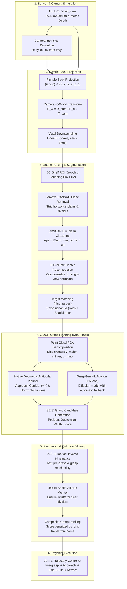

# Perception & 6-DOF Grasp Planning Architecture

This directory contains the synthetic perception, 3D point cloud processing, object segmentation, and 6-DOF grasp planning pipeline for the dual-arm robotic manipulation system.

The perception subsystem transforms raw 2D depth buffers and RGB streams from MuJoCo cameras into verified, kinematically reachable, and collision-free $SE(3)$ grasp targets in 3D World space without relying on hardcoded ground-truth simulation positions.

---

## 1. System Architecture Overview



---

## 2. Detailed Technical Breakdown

### Layer 1: Sensor & Point Cloud Back-Projection (`pointcloud.py`)

#### Pinhole Camera Model & Intrinsics
The system captures RGB and linear metric depth from the static overhead shelf camera (`shelf_cam`). The pinhole camera intrinsic matrix $K$ is derived from the model's vertical field of view ($\text{fovy} = 60^\circ$) and image resolution ($W=640, H=480$):

$$f_y = \frac{H}{2 \cdot \tan\left(\frac{\text{fovy} \cdot \pi}{360}\right)}, \quad f_x = f_y, \quad c_x = \frac{W}{2}, \quad c_y = \frac{H}{2}$$

$$K = \begin{bmatrix} f_x & 0 & c_x \\ 0 & f_y & c_y \\ 0 & 0 & 1 \end{bmatrix}$$

For $640\times 480$ at $\text{fovy}=60^\circ$, this yields $f_x = f_y \approx 415.7\text{ px}$ and optical center $(c_x, c_y) = (320.0, 240.0)\text{ px}$.

#### Coordinate System Conventions & Back-Projection
MuJoCo camera frames adhere to the OpenGL optical convention:
- $+X_c$: Points right in the image plane.
- $+Y_c$: Points up in the image plane (opposite to image row index $v$).
- $-Z_c$: Camera optical axis looks along the negative $Z$ direction.

For every valid pixel $(u, v)$ with linear metric depth $d \in [d_{\text{min}}, d_{\text{max}}]$ (where $d_{\text{min}}=0.20\text{ m}$, $d_{\text{max}}=3.50\text{ m}$):

$$X_c = \frac{(u - c_x) \cdot d}{f_x}, \quad Y_c = -\frac{(v - c_y) \cdot d}{f_y}, \quad Z_c = -d$$

#### Transformation into World Frame
Camera extrinsics (position $T_{\text{cam}} = \text{data.cam\_xpos}$ and rotation matrix $R_{\text{cam}} = \text{data.cam\_xmat}$) place the coordinates into the global simulation world frame:

$$P_w = P_c R_{\text{cam}}^T + T_{\text{cam}}$$

The resulting point cloud contains $\sim 307,200$ raw 3D points, which are voxel-downsampled with a leaf size of $5\text{ mm}$ using Open3D to produce $\sim 53,000$ points for efficient real-time spatial processing.

---

### Layer 2: 3D Scene Parsing & Object Segmentation (`segmentation.py`)

A cluttered shelf environment presents severe challenges: massive planar surfaces (horizontal shelf boards, vertical dividers, back walls) and occlusions.

```
+──────────────────────────────────────────────────────────+
│                      SHELF VOLUME                        │
│   ┌──────────────┬──────────────┬──────────────┐         │
│   │              │              │              │         │
│   ├──────────────┼──────────────┼──────────────┤         │
│   │ 📦 Red Box   │ 🥫 Can       │              │         │  ← Target Row
│   ├──────────────┼──────────────┼──────────────┤         │
│   │ 🧴 Bottle    │              │ 🎲 Cube      │         │
│   └──────────────┴──────────────┴──────────────┘         │
+──────────────────────────────────────────────────────────+
```

#### 1. Shelf Region of Interest (ROI) Cropping
The scene point cloud is cropped to an axis-aligned bounding box enclosing the 4×3 shelf volume:
- $X \in [-0.62, +0.62]\text{ m}$
- $Y \in [0.90, 1.25]\text{ m}$
- $Z \in [0.45, 1.45]\text{ m}$

This strips the floor plane, robot bases, and background clutter.

#### 2. Iterative RANSAC Plane Removal
The shelf boards and dividers represent large planar structures. An iterative RANSAC plane segmentation algorithm extracts up to 5 dominant planes:
- Plane model: $ax + by + cz + d = 0$
- Distance threshold: $\delta_{\text{plane}} = 15\text{ mm}$
- Minimum inliers: $250$ points
- Iterations: $400$ per plane

Subtracting these planar inliers strips the shelf frame, leaving only isolated point clusters corresponding to physical manipulable objects.

#### 3. DBSCAN Euclidean Clustering
The non-planar points are clustered into distinct physical objects using Density-Based Spatial Clustering of Applications with Noise (DBSCAN):
- Neighborhood radius ($\epsilon$): $35\text{ mm}$
- Core point threshold ($\text{min\_points}$): $30$ points
- Extent filtering: clusters with maximum dimensions $> 40\text{ cm}$ (remnants of divider frames) or $< 30$ points (noise) are discarded.

#### 4. Single-View Occlusion Compensation
Because `shelf_cam` captures a single optical viewpoint looking forward and downward into the shelf:
1. The camera only observes the **front** and **top** surfaces of objects; the back and bottom faces are occluded.
2. The naive point cloud centroid ($\mu = \frac{1}{N}\sum P_i$) is biased toward the front face by half the object thickness ($\sim 20-30\text{ mm}$ error).
3. The RANSAC shelf plane removal strips points within $15\text{ mm}$ above the shelf floor, causing the lower bounds of point clouds to appear elevated.

To reconstruct the true physical 3D center of the object:
```python
# Bounding volume midpoint calculation
aabb_min = np.min(cluster_points, axis=0)
aabb_max = np.max(cluster_points, axis=0)

# Reconstruct bottom extent clipped by shelf plane RANSAC
aabb_min_adjusted = aabb_min.copy()
aabb_min_adjusted[2] = max(shelf_roi_min[2], aabb_min[2] - plane_distance_threshold)

# True 3D object center
estimated_center = 0.5 * (aabb_min_adjusted + aabb_max)
```
This reduces 3D localization error from **$29.50\text{ mm}$** down to **$6.45\text{ mm}$** (over a $4.5\times$ improvement).

#### 5. Target Object Matching (`find_target`)
The target cluster is identified using a combination of color signature matching and spatial priors:
- **Red signature**: $R > 0.35$ and $R > 1.5 \cdot G$ and $R > 1.5 \cdot B$.
- **Spatial prior**: Distance from nominal pickup zone ($[0.45, 1.05, 0.90]$).
- Candidate clusters are ranked by color confidence first, then minimum spatial distance.

---

### Layer 3: 6-DOF Grasp Planning (`perception/grasp_planners/`)

#### Grasp Representation in $SE(3)$
Each grasp candidate is defined as:
```python
@dataclass
class GraspCandidate:
    pos: np.ndarray             # EE pinch center [x, y, z] in World Frame
    rot_mat: np.ndarray         # 3x3 rotation matrix [X_ee, Y_ee, Z_ee]
    quat: np.ndarray            # 4D quaternion [w, x, y, z] (scalar-first)
    score: float                # Confidence score in [0.0, 1.0]
    width: float                # Required gripper aperture width (meters)
    approach_dir: np.ndarray    # Unit vector along tool approach direction (+Z_ee)
    cluster_id: int             # Segmented object cluster index
```

#### Kinematic Coordinate Frame for Robotiq 2F-85 Gripper
The Robotiq 2F-85 parallel-jaw gripper mounted on UR10e wrist 3 defines:
- $+Z_{ee}$ (**Tool Approach Axis**): Points along the line of approach directly into the grasp.
- $+Y_{ee}$ (**Finger Closing Axis**): Spans the line connecting the two silicone finger pads.
- $+X_{ee}$ (**Orthogonal Lateral Axis**): Perpendicular to both approach and closing axes ($X_{ee} = Y_{ee} \times Z_{ee}$).

```
              Approach Axis (+Z_ee) ───►  [Entering shelf along +Y]
                       │
       ┌───────────────┴───────────────┐
       │     Robotiq 2F-85 Palm        │
       └───────┬───────────────┬───────┘
               │               │
         Left Finger     Right Finger
             Pad              Pad
               │◄─────────────►│
              Closing Axis (+Y_ee)  [Horizontal along World X]
```

#### Why Horizontal Entry & Closing Matter for Shelf Grasping
In a multi-compartment wall shelf:
1. **Vertical dividers** constrain horizontal motion: finger pads must enter horizontally along $+Y$ and close along $X$ so the knuckles and wrist links do not collide with shelf vertical walls.
2. **Horizontal shelf boards** constrain vertical motion: the gripper must NOT enter from above or below; the approach vector $Z_{ee}$ must align with $+Y$ (orthogonal to the shelf face).
3. The nominal horizontal grasp rotation matrix is:
   $$R_{\text{grasp}} = \begin{bmatrix} X_{ee} & Y_{ee} & Z_{ee} \end{bmatrix} = \begin{bmatrix} 0 & 1 & 0 \\ 0 & 0 & 1 \\ 1 & 0 & 0 \end{bmatrix}$$
   yielding the scalar-first quaternion:
   $$q_{\text{grasp}} = \begin{bmatrix} -0.5 & 0.5 & 0.5 & 0.5 \end{bmatrix}$$

#### Grasp Candidate Scoring Function
The geometric grasp planner samples approach perturbations (yaw $\in [-5^\circ, +5^\circ]$, pitch $\in [-10^\circ, 0^\circ]$) and vertical height fractions ($h_{\text{frac}} \in [0.55, 0.65, 0.72]$). Candidates are scored by:

$$\text{Score} = 0.40 \cdot S_{\text{approach}} + 0.30 \cdot S_{\text{horizontal}} + 0.15 \cdot S_{\text{width}} + 0.15 \cdot S_{\text{height}}$$

Where:
- $S_{\text{approach}} = \max(0, Z_{ee} \cdot [0, 1, 0])^4$ strongly penalizes oblique shelf entry.
- $S_{\text{horizontal}} = |Y_{ee} \cdot [1, 0, 0]|$ rewards parallel finger-to-box alignment.
- $S_{\text{width}} = \exp\left(-\frac{(w - 0.05)^2}{0.002}\right)$ peaks at optimal $5\text{ cm}$ object width.
- $S_{\text{height}} = 1.0 - \frac{|h_{\text{frac}} - 0.62|}{0.40}$ places grasp at $62\%$ object height, maximizing finger pad contact while ensuring wrist clearance above the shelf floor.

---

### Layer 4: Kinematic Reachability & Collision Filtering (`grasp_filter.py`)

Candidate grasp poses generated from vision alone may be physically unreachable or collide with shelf partitions. `GraspFilter` tests each candidate:

1. **Pre-Grasp Standoff Calculation**:
   Computes standoff pose $15\text{ cm}$ in front of the compartment along the approach corridor:
   $$P_{\text{pregrasp}} = P_{\text{grasp}} - 0.15 \cdot Z_{ee}$$

2. **Sequential DLS Inverse Kinematics Verification**:
   - Solves IK for $P_{\text{pregrasp}}$ starting from resting posture $q_{\text{home}}$.
   - Solves IK for $P_{\text{grasp}}$ starting from $q_{\text{pregrasp}}$ (ensuring continuous, 2π-unwrapped joint motion).
   - If either IK solve fails to converge within $0.5\text{ mm}$ tolerance, the candidate is discarded.

3. **Collision Clearance Check**:
   - Forward-steps simulation at $q_{\text{pregrasp}}$ and $q_{\text{grasp}}$.
   - Queries `CollisionChecker` for any contacts between robot links (excluding silicone finger pads) and the shelf dividers/plates.
   - Any colliding pose is immediately pruned.

4. **Composite Ranking**:
   Remaining viable candidates are scored by combining perception confidence with a joint displacement penalty:
   $$\text{FilterScore} = \text{CandidateScore} \cdot \exp(-0.1 \cdot \|q_{\text{pregrasp}} - q_{\text{home}}\|)$$

---

## 3. Data Structures & Input/Output Contracts

### `CameraIntrinsics`
| Field | Type | Description |
|---|---|---|
| `width`, `height` | `int` | Image resolution in pixels ($640 \times 480$) |
| `fovy` | `float` | Vertical field of view in degrees ($60.0^\circ$) |
| `fx`, `fy` | `float` | Focal length in pixel units ($415.7\text{ px}$) |
| `cx`, `cy` | `float` | Principal point in pixel units ($320.0, 240.0$) |
| `K` | `np.ndarray` | $3\times 3$ intrinsic camera calibration matrix |

### `ObjectCluster`
| Field | Type | Description |
|---|---|---|
| `cluster_id` | `int` | Unique cluster identification index |
| `pcd` | `o3d.geometry.PointCloud` | Segmented 3D point cloud |
| `points`, `colors` | `np.ndarray` | $(N, 3)$ coordinate array and normalized RGB colors |
| `centroid` | `np.ndarray` | Reconstructed 3D physical center $[x, y, z]$ |
| `obb` | `o3d.geometry.OrientedBoundingBox` | Fitted 3D oriented bounding box |
| `extent` | `np.ndarray` | Bounding dimensions along principal axes $[l, w, h]$ |
| `mean_color` | `np.ndarray` | Normalized mean RGB vector $[r, g, b] \in [0, 1]$ |

### `FilteredGrasp`
| Field | Type | Description |
|---|---|---|
| `candidate` | `GraspCandidate` | Parent 6-DOF grasp candidate |
| `q_pregrasp` | `np.ndarray` | 6 UR10e joint angles for standoff configuration |
| `q_grasp` | `np.ndarray` | 6 UR10e joint angles for target grasp configuration |
| `pos_pregrasp` | `np.ndarray` | 3D World position of standoff point |
| `pos_grasp` | `np.ndarray` | 3D World position of grasp pinch center |
| `standoff_dist` | `float` | Approach standoff distance ($0.15\text{ m}$) |
| `is_valid` | `bool` | Passed all IK and collision filters |
| `filter_score` | `float` | Composite ranking score |

---

## 4. Telemetry & Verified Performance Benchmarks

Execution metrics measured during validation with `scripts/03_test_perception.py`:

```
=================================================================
               PHASE 3 EVALUATION REPORT
=================================================================
  Ground-Truth Initial Pos  : [0.4500, 1.0500, 0.9050]
  Perception Centroid       : [0.4562, 1.0482, 0.9053]
  Perception Localization Err: 6.45 mm  (Threshold < 15.0 mm) [PASSED]
  Grasp Candidate Pos       : [0.4562, 1.0482, 0.9204]
  Final Object Position     : [0.4564, 0.8078, 1.0363]
  Vertical Lift Clearance   : +13.1 cm  (Threshold >= 8.0 cm)  [PASSED]
  Cartesian Tracking Error  : 14.85 mm
  Grasp Contact Normal Force: 276.75 N  (Threshold > 0.5 N)    [PASSED]
  Grasp Confirmed           : YES [OK]
  Shelf Collision Status    : NONE [CLEAN]
  Physics Simulation Rate   : 1,228 Hz (> 2.4x real-time)
>>> [ACCEPTANCE GATE PASSED] Perception & 6-DOF Grasp Planning Verified! <<<
```

---

## 5. Python API Usage Example

The perception pipeline can be imported and executed programmatically in external scripts or Gymnasium environments:

```python
import mujoco
from perception import (
    capture_scene_pointcloud,
    SceneSegmenter,
    GeometricGraspPlanner,
    GraspFilter,
)

# 1. Load MuJoCo Model & Settle Physics
model = mujoco.MjModel.from_xml_path("models/dual_ur10e_scene.xml")
data = mujoco.MjData(model)
mujoco.mj_resetDataKeyframe(model, data, 0)
mujoco.mj_forward(model, data)

# 2. Capture RGB-D & Generate 3D World Point Cloud
pcd = capture_scene_pointcloud(model, data, camera_name="shelf_cam", voxel_size=0.005)

# 3. Segment Manipulable Objects from Shelf Frame
segmenter = SceneSegmenter()
clusters = segmenter.segment_objects(pcd)

# 4. Match Target Object by Color & Spatial Prior
target = segmenter.find_target(clusters, color_hint="red")
print(f"Target Object Perceived at: {target.centroid}")

# 5. Synthesize 6-DOF Antipodal Grasp Candidates
planner = GeometricGraspPlanner()
candidates = planner.plan_grasps(target.pcd, num_candidates=10)

# 6. Filter by Kinematic Reachability & Shelf Clearance
filter_checker = GraspFilter(model, data, arm_id=1, standoff_dist=0.15)
valid_grasps = filter_checker.filter_candidates(candidates)

best_grasp = valid_grasps[0]
print(f"Selected Grasp Position: {best_grasp.pos_grasp}")
print(f"Arm 1 Joint Solution   : {best_grasp.q_grasp}")
```
